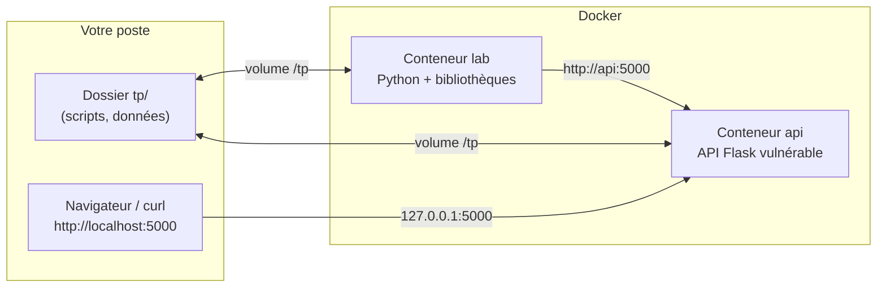

[Sommaire](Readme.md) · [Chapitre suivant →](01-Panorama-et-notions-cles.md)

# Préparer son environnement

Les TP de ce cours tournent dans un **laboratoire Docker** : une image Python
qui contient toutes les bibliothèques nécessaires, et une petite API
volontairement vulnérable. Ce chapitre l'installe et le vérifie. Comptez une
dizaine de minutes ; lancez la construction de l'image à l'avance si
votre connexion est lente.

## 🎯 Objectifs

- Construire l'image du laboratoire.
- Savoir lancer un script dans le laboratoire et y ouvrir un terminal.
- Comprendre pourquoi on pratique la sécurité **dans un environnement isolé**.
- Créer son **fichier de rendu** et générer ses données personnelles.

---

## 1. Pourquoi un laboratoire ?

Pour comprendre une attaque, il faut la voir fonctionner. Mais on ne la
pratique jamais sur un système réel :

- **c'est illégal** sans autorisation écrite du propriétaire, même sans
  intention de nuire (articles 323-1 et suivants du Code pénal : jusqu'à 3 ans
  d'emprisonnement et 100 000 € d'amende pour un simple accès frauduleux) ;
- **c'est dangereux** : un code d'exploitation mal maîtrisé peut détruire des
  données ou rendre un service indisponible.

Les professionnel·le·s de la sécurité travaillent donc dans des laboratoires
jetables, et les tests d'intrusion se font sous contrat, dans un périmètre
défini. Docker nous donne ce laboratoire à peu de frais : un conteneur se crée,
se casse et se recrée en quelques secondes.



L'API n'est publiée que sur `127.0.0.1` : elle n'est joignable que depuis votre
propre machine, pas depuis le réseau de l'école ou du café. Une application
vulnérable exposée sur toutes les interfaces serait une porte ouverte.

---

## 2. Installer

**Prérequis** : Docker Desktop (Windows, macOS) ou Docker Engine avec le plugin
Compose (Linux), et une copie du dépôt du cours.

```bash
git clone <adresse du dépôt du cours>
cd <dépôt>/tp
docker compose build
```

La construction télécharge l'image `python:3.12-slim` et installe les
bibliothèques listées dans `tp/requirements.txt` : `cryptography`, `PyJWT`,
`pandas`, `scikit-learn`, `flask`, `requests`.

## 3. Vérifier

```bash
docker compose run --rm lab python verifier_lab.py
```

Résultat attendu :

```text
Python 3.12.x
  [OK] cryptography 4x.x
  [OK] jwt 2.x
  [OK] pandas 2.x
  [OK] sklearn 1.x
  [OK] flask 3.x
  [OK] requests 2.x
Laboratoire prêt !
```

## 4. Créer votre rendu

Les TP sont évalués à partir d'un fichier, `tp/rendu.json`, que vous complétez
au fil de la journée et que vous déposez à la fin. Créez-le **maintenant**, avec
vos prénom et nom tels qu'ils figurent sur la liste d'appel :

```bash
docker compose run --rm lab python rendu.py init "Prénom Nom"
```

Cette commande fait deux choses :

1. elle crée `rendu.json` à votre nom ;
2. elle **génère vos données personnelles** pour les TP : fuite de mots de
   passe, jeton JWT, dossiers patients, journal d'accès. Les mots de passe à
   casser, les secrets à retrouver, les adresses des attaquants dépendent de
   votre nom.

Conséquence : **vos réponses ne sont pas celles de votre voisin·e**, ni celles
des corrections. Les corrections montrent la démarche et les résultats sur un
*jeu de référence* ; vos chiffres à vous sont différents, et c'est eux qu'il
faut rendre.

À la fin de chaque TP, un encadré **📤 À rendre** indique quoi enregistrer, avec
deux commandes à lancer depuis le dossier `tp/` (ou `../rendu.py` depuis un
sous-dossier) :

| Commande | Effet |
|---|---|
| `python rendu.py consigner <clé> <valeur>` | enregistre une réponse : un texte, un nombre, ou du JSON entre apostrophes (`'{"1": "C"}'`) |
| `python rendu.py joindre <clé> <fichier>` | joint le contenu d'un fichier (script, CSV, Markdown) |
| `python rendu.py etat` | affiche ce qui est fait et ce qui manque |

Vous pouvez aussi consigner directement depuis un script Python :

```python
import sys
sys.path.append("..")          # rendu.py est dans le dossier parent
from rendu import consigner

consigner("03.comptes_identiques", ["alice.martin", "bruno.petit"])
```

Une réponse peut être consignée autant de fois que nécessaire : seule la
dernière compte.

> ⚠️ Ne relancez pas `init` avec un autre nom : vos données changeraient et vos
> réponses ne correspondraient plus. Si vous devez tout recommencer :
> `python rendu.py init "Prénom Nom" --forcer`.

## 5. Les trois commandes à retenir

| Commande | Effet |
|---|---|
| `docker compose run --rm lab python <script>` | lance un script dans le laboratoire |
| `docker compose run --rm lab` | ouvre un terminal `bash` dans le laboratoire (`exit` pour sortir) |
| `docker compose up api` | démarre l'API vulnérable (chapitre 05) ; `Ctrl+C` pour l'arrêter |

Le dossier `tp/` est **monté** dans le conteneur : vous éditez les scripts avec
votre éditeur habituel, sur votre poste, et le conteneur voit vos
modifications aussitôt. Les fichiers créés dans le conteneur sous `/tp`
apparaissent de même sur votre poste.

> 💡 Vous préférez travailler sans Docker ? Un environnement virtuel Python 3.11
> ou plus récent fait l'affaire : `python -m venv .venv`, l'activer, puis
> `pip install -r requirements.txt`. Les commandes du cours s'écrivent alors
> sans le préfixe `docker compose run --rm lab`.

---

## ✅ Exercice

1. Ouvrez un terminal dans le laboratoire et affichez l'utilisateur courant
   avec `whoami`.
2. Créez un fichier `/tp/bonjour.txt` depuis le conteneur, puis vérifiez qu'il
   apparaît dans le dossier `tp/` de votre poste. Supprimez-le.
3. Quel est le risque de lancer un conteneur sous l'utilisateur `root` ?

<details>
<summary>Voir la correction</summary>

1. `docker compose run --rm lab`, puis `whoami` affiche `root` : l'image
   `python:3.12-slim` s'exécute par défaut en super-utilisateur.
2. `echo bonjour > /tp/bonjour.txt` dans le conteneur ; le fichier apparaît
   dans `tp/` grâce au volume. `rm /tp/bonjour.txt` pour le supprimer.
3. Si un attaquant prend le contrôle du processus (via une faille de
   l'application), il est `root` dans le conteneur : il peut modifier tout le
   système de fichiers du conteneur, et tout ce qui est monté - ici, vos
   fichiers de TP. Une faille du moteur de conteneurs pourrait même lui
   permettre de s'en échapper. En production, on ajoute donc un utilisateur
   dédié dans le `Dockerfile` (`RUN useradd -m app` puis `USER app`) : c'est
   le **principe du moindre privilège**, que l'on retrouvera au chapitre 04.
   Pour un laboratoire jetable, on s'en dispense.

</details>

---

[Sommaire](Readme.md) · [Chapitre suivant →](01-Panorama-et-notions-cles.md)
