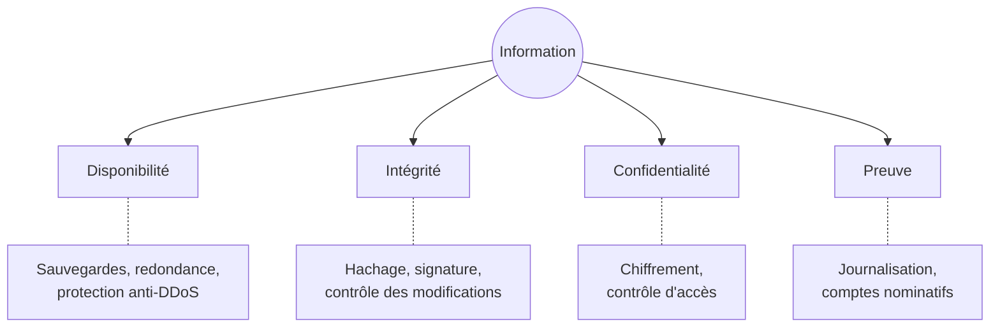

[← Chapitre précédent](00-Preparer-son-environnement.md) · [Sommaire](Readme.md) · [Chapitre suivant →](02-Analyse-de-risques-et-modelisation-des-menaces.md)

# Panorama et notions clés

Avant de se défendre, il faut savoir contre qui, contre quoi, et ce que l'on
protège. Ce chapitre pose le décor - les attaques qui font l'actualité, ceux
qui les mènent - puis le vocabulaire qui servira toute la journée.

## 🎯 Objectifs

- Citer les principales familles d'attaques et les grands types d'attaquants.
- Définir les quatre critères **DICP** et les illustrer sur des données.
- Distinguer **actif**, **menace**, **vulnérabilité** et **risque**.
- Connaître les acteurs publics français de la cybersécurité.

---

## 1. Quelques incidents récents

La cybersécurité n'est pas un sujet théorique. Quelques affaires suffisent à
montrer que **les données sont la cible**, et que l'entrée se fait souvent par
une porte banale.

| Date | Victime | Ce qui s'est passé | Porte d'entrée |
|---|---|---|---|
| 2017 | Monde entier | **NotPetya** paralyse Maersk, Saint-Gobain, Merck… plusieurs milliards de dollars de pertes | mise à jour piégée d'un logiciel comptable ukrainien |
| 2022 | Centre hospitalier sud-francilien (Corbeil-Essonnes) | **rançongiciel** : hôpital en mode dégradé pendant des semaines, données de patients publiées | compromission du système d'information |
| 2023 | Des milliers d'organisations | logiciel de transfert **MOVEit** exploité par le groupe Cl0p, données volées en masse | **injection SQL** dans l'application web |
| 2023 | Samsung | des ingénieurs collent du code source confidentiel dans ChatGPT | usage non encadré d'un **service d'IA** externe |
| 2024 | Viamedis et Almerys | données de **33 millions** d'assurés exposées | identifiants de professionnels de santé **hameçonnés** |
| 2024 | France Travail | données de **43 millions** de personnes exfiltrées | comptes de conseillers usurpés |
| 2024 | XZ Utils | une porte dérobée glissée dans une bibliothèque de compression présente sur la plupart des serveurs Linux, découverte de justesse | contributeur malveillant patient : **chaîne d'approvisionnement** |

On retrouvera plusieurs de ces portes d'entrée en TP : l'injection SQL au
chapitre 05, l'identité au chapitre 04, la chaîne d'approvisionnement et l'IA
au chapitre 07.

## 2. Qui attaque, et pourquoi ?

| Attaquant | Motivation | Modes d'action typiques |
|---|---|---|
| **Cybercriminels** | l'argent | rançongiciels, vol et revente de données, fraude au président, hameçonnage de masse |
| **États** | l'espionnage, le sabotage, l'influence | attaques ciblées et discrètes, longues (des mois), sur les infrastructures critiques et la recherche |
| **Hacktivistes** | une cause politique | déni de service (DDoS), défiguration de sites, divulgation de documents |
| **Initiés** | vengeance, appât du gain… ou simple **négligence** | abus de droits, copie de données, erreur de configuration |
| **Opportunistes** | le défi, la curiosité | outils prêts à l'emploi, scans automatisés d'Internet |

Le crime s'est industrialisé : des groupes louent leur rançongiciel "clés en
main" à des affiliés (*Ransomware as a Service*), d'autres vendent des accès
déjà obtenus à des réseaux d'entreprise. Un attaquant n'a plus besoin d'être
expert : il lui suffit d'acheter.

> 💡 Retenez qu'une grande partie des incidents ne vient pas d'un génie du
> clavier mais d'une **erreur humaine** : un mot de passe réutilisé, un
> compartiment de stockage cloud laissé public, un clic sur une pièce jointe.

## 3. Les familles d'attaques

- **Hameçonnage** (*phishing*) : un faux message pousse à cliquer, à saisir ses
  identifiants ou à ouvrir une pièce jointe piégée. Première porte d'entrée.
- **Rançongiciel** (*ransomware*) : les données sont chiffrées, et souvent
  volées avant ("double extorsion") ; on paye pour les récupérer et pour
  qu'elles ne soient pas publiées.
- **Déni de service** (DoS, DDoS) : on sature un service pour le rendre
  indisponible.
- **Exploitation de vulnérabilité** : on utilise un défaut logiciel (injection,
  dépassement de tampon, mauvaise configuration) pour prendre le contrôle.
- **Vol d'identifiants** : réutilisation de mots de passe déjà fuités
  (*credential stuffing*), force brute, vol de jetons de session.
- **Attaque de la chaîne d'approvisionnement** : on compromet un fournisseur,
  une bibliothèque, un modèle pré-entraîné, pour atteindre ses clients.
- **Ingénierie sociale** : on manipule une personne - par téléphone, par
  courriel, aujourd'hui avec des voix et vidéos synthétiques - pour obtenir un
  accès ou un virement.

---

## 4. Ce que l'on protège : les critères DICP

La sécurité d'une information s'évalue selon quatre critères.

| Critère | Question | Exemple d'atteinte sur des données |
|---|---|---|
| **D**isponibilité | L'information est-elle accessible quand on en a besoin ? | l'entrepôt de données est chiffré par un rançongiciel ; l'API de prédiction est saturée |
| **I**ntégrité | L'information est-elle exacte et complète, non modifiée sans autorisation ? | un attaquant modifie les données d'entraînement ; un IBAN est remplacé dans une base fournisseurs |
| **C**onfidentialité | L'information n'est-elle accessible qu'aux personnes autorisées ? | une base clients est exfiltrée ; un notebook avec des données de santé est partagé publiquement |
| **P**reuve (traçabilité) | Peut-on savoir qui a fait quoi, et le prouver ? | les journaux d'accès sont effacés ; tout le monde utilise le même compte de service |

On rencontre aussi le sigle **CIA** en anglais (*Confidentiality, Integrity,
Availability*), la "triade", auquel on ajoute selon les auteurs
l'authenticité ou la non-répudiation, que recouvre le P de DICP.

Pour chaque actif, on fixe un **niveau de besoin** sur chaque critère (de 1 à
4, par exemple). Une base de données publiques en open data a un besoin de
confidentialité nul mais un fort besoin d'intégrité ; un jeu de données de
santé a un besoin maximal en confidentialité.

## 5. Le vocabulaire du risque

Ces mots sont souvent confondus. Ils ne désignent pourtant pas la même chose :

| Terme | Définition | Exemple |
|---|---|---|
| **Actif** (ou bien) | ce qui a de la valeur et doit être protégé : données, processus, matériel, logiciel, réputation | la base clients |
| **Vulnérabilité** | une faiblesse qui peut être exploitée | l'API concatène les paramètres dans ses requêtes SQL |
| **Menace** | une cause potentielle d'incident, liée à une source (un attaquant, une erreur, un sinistre) | un cybercriminel cherchant des données à revendre |
| **Attaque** | la tentative effective d'exploiter une vulnérabilité | l'envoi d'une injection SQL |
| **Risque** | la possibilité qu'une menace exploite une vulnérabilité et cause un dommage à un actif | vol de la base clients via l'API |
| **Impact** (gravité) | les conséquences si le risque se réalise | amende CNIL, perte de confiance, coût de notification |
| **Mesure de sécurité** | ce qui réduit la vraisemblance ou l'impact | requêtes paramétrées, chiffrement de la base |
| **Risque résiduel** | ce qui reste une fois les mesures appliquées | accepté, formellement, par la direction |

Le risque se mesure classiquement par :

> **Risque = Vraisemblance × Gravité**

Une vulnérabilité sans menace (une faille sur un système isolé, éteint) ne fait
pas de risque ; une menace sans vulnérabilité non plus. Le travail de sécurité
consiste à réduire l'un ou l'autre, ou l'impact.

Dernier terme : la **surface d'attaque**, l'ensemble des points par lesquels un
attaquant peut tenter d'entrer - ports ouverts, API, comptes, dépendances,
fichiers importés, utilisateurs. Chaque notebook exposé sur Internet, chaque
bibliothèque ajoutée, chaque clé d'API créée l'agrandit.

## 6. Les grands principes

Quatre principes reviendront dans tous les chapitres :

1. **Défense en profondeur** : empiler des protections indépendantes, pour
   qu'une seule défaillance ne suffise pas (chapitre 08).
2. **Moindre privilège** : chaque utilisateur, service ou modèle n'a que les
   droits strictement nécessaires (chapitre 04).
3. **Sécurité dès la conception** (*security by design*) : la sécurité se
   pense au moment de l'architecture, pas après l'incident (chapitre 02).
4. **Zéro confiance** (*zero trust*) : on ne fait pas confiance à une requête
   parce qu'elle vient "de l'intérieur" du réseau ; chaque accès est
   authentifié et autorisé.

## 7. Qui fait quoi en France ?

| Acteur | Rôle |
|---|---|
| **ANSSI** | Agence nationale de la sécurité des systèmes d'information : autorité nationale, publie guides et recommandations (dont le *Guide d'hygiène informatique*), certifie des produits et prestataires |
| **CERT-FR** | centre de veille et de réponse de l'ANSSI : alertes, avis de vulnérabilités |
| **CNIL** | Commission nationale de l'informatique et des libertés : contrôle l'application du RGPD, reçoit les notifications de violation de données |
| **Cybermalveillance.gouv.fr** | assistance aux particuliers, entreprises et collectivités victimes |
| **ComCyberGend, OFAC** | gendarmerie et police spécialisées : on y porte plainte |

Les textes européens structurent l'ensemble : le **RGPD** pour les données
personnelles (chapitre 06), la directive **NIS 2** pour la sécurité des
entités essentielles et importantes, l'**AI Act** pour les systèmes d'IA
(chapitre 07), le **Cyber Resilience Act** pour les produits numériques.

---

## ✅ Exercice 1 - Classer des incidents

Pour chacun des incidents suivants, indiquez le ou les critères DICP atteints
et le type d'attaquant le plus probable.

1. Un ancien salarié se connecte avec son compte, resté actif, et télécharge le
   fichier des prospects avant de rejoindre un concurrent.
2. Un modèle de scoring de crédit se met à accepter des dossiers frauduleux :
   quelqu'un a injecté des milliers de faux exemples "bons payeurs" dans les
   données d'entraînement.
3. Le site d'une collectivité est inaccessible pendant une élection, saturé de
   requêtes ; un groupe revendique l'attaque sur un réseau social.
4. Tous les serveurs d'une PME affichent un message exigeant 2 bitcoins ; les
   fichiers sont illisibles.
5. Un data scientist publie sur GitHub un notebook contenant la clé d'accès au
   stockage cloud de l'entreprise. Trois heures plus tard, des machines de
   minage de cryptomonnaie tournent sur le compte.
6. Après une fuite, impossible de savoir quels comptes ont consulté le jeu de
   données : il est accessible par un compte partagé `data_team`.

Voir la correction

| # | Critères atteints | Attaquant |
|---|---|---|
| 1 | **C** (fichier exfiltré) | initié malveillant - et une faille de processus : le départ du salarié n'a pas déclenché la désactivation du compte |
| 2 | **I** (données et modèle corrompus) | cybercriminel (fraude) ; c'est un **empoisonnement de données**, vu au chapitre 07 |
| 3 | **D** | hacktivistes (DDoS revendiqué, contexte politique) |
| 4 | **D** surtout, souvent **C** aussi (double extorsion) | cybercriminels (rançongiciel) |
| 5 | **C** (clé exposée), puis **D** et coût financier (ressources détournées) | opportunistes : des robots scrutent GitHub en permanence à la recherche de clés ; voir le chapitre 04 |
| 6 | **P** (aucune traçabilité) | - c'est une vulnérabilité, qui aggrave n'importe quel incident |

---

## ✅ Exercice 2 - Actif, menace, vulnérabilité, risque

Une enseigne de distribution dispose d'une plateforme data : un entrepôt de
données (historique d'achats de 5 millions de clients avec nom, adresse,
courriel), des notebooks Jupyter partagés par l'équipe, et un modèle de
recommandation exposé par une API au site web.

1. Listez au moins quatre actifs, et évaluez leurs besoins DICP (faible, moyen,
   fort).
2. Pour l'un d'eux, formulez un risque complet : menace, vulnérabilité,
   impact.

Voir la correction

1. Exemples d'actifs et de besoins :

| Actif | D | I | C | P |
|---|---|---|---|---|
| Données clients de l'entrepôt | moyen | fort | **fort** (données personnelles) | fort |
| Modèle de recommandation | moyen | fort | moyen (savoir-faire) | faible |
| API de recommandation | **fort** (le site en dépend) | fort | faible | moyen |
| Notebooks et leurs identifiants | faible | moyen | **fort** (ils contiennent souvent des clés) | moyen |
| Réputation de l'enseigne | - | - | - | - |

La réputation est un actif *primordial* (on parle aussi de valeur métier) :
elle ne se protège pas directement, mais à travers les actifs *supports*
(serveurs, bases, comptes) dont elle dépend.

2. Un exemple de risque complet :
   - **actif** : les données clients de l'entrepôt ;
   - **menace** : un cybercriminel cherchant des données à revendre ;
   - **vulnérabilité** : les notebooks partagés contiennent en clair le mot de
     passe d'un compte de lecture de l'entrepôt, et le serveur Jupyter est
     accessible depuis Internet ;
   - **impact** : vol de 5 millions de fiches, notification à la CNIL et aux
     personnes, amende pouvant atteindre 4 % du chiffre d'affaires mondial,
     perte de confiance des clients.

---

[← Chapitre précédent](00-Preparer-son-environnement.md) · [Sommaire](Readme.md) · [Chapitre suivant →](02-Analyse-de-risques-et-modelisation-des-menaces.md)
