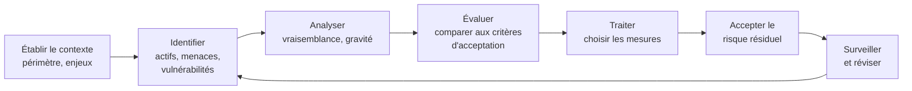
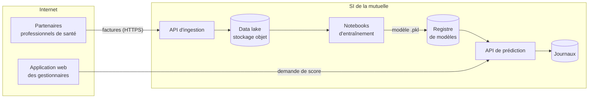

[← Chapitre précédent](01-Panorama-et-notions-cles.md) · [Sommaire](Readme.md) · [Chapitre suivant →](03-Cryptographie-appliquee.md)

# Analyse de risques et modélisation des menaces

On ne peut pas tout protéger avec le même soin : le budget, le temps et la
patience des utilisateurs sont limités. L'analyse de risques sert à
**décider** où porter l'effort. La modélisation des menaces en est la version
"terrain", pratiquée par les équipes techniques sur une architecture
précise.

## 🎯 Objectifs

- Décrire la démarche de gestion des risques et ses quatre options de
  traitement.
- Positionner un risque sur une matrice gravité × vraisemblance.
- Connaître les référentiels courants : ISO 27001/27005, EBIOS RM, NIST CSF.
- Modéliser les menaces d'une architecture avec **STRIDE**.

---

## 1. La démarche de gestion des risques



C'est un **cycle** : une nouvelle application, un nouveau fournisseur, une
nouvelle menace, et l'analyse se reprend. Cette démarche est celle de la norme
**ISO/IEC 27005**, au service d'un système de management de la sécurité de
l'information (SMSI) certifiable selon l'**ISO/IEC 27001**.

### Les quatre façons de traiter un risque

| Option | Principe | Exemple |
|---|---|---|
| **Réduire** | appliquer des mesures qui baissent la vraisemblance ou la gravité | chiffrer la base, activer la MFA |
| **Transférer** | faire porter tout ou partie du risque par un tiers | souscrire une cyberassurance, confier l'hébergement à un prestataire qualifié |
| **Éviter** | renoncer à l'activité qui crée le risque | ne pas collecter la date de naissance si elle ne sert pas |
| **Accepter** | prendre le risque en connaissance de cause | risque faible, mesure plus coûteuse que le dommage |

L'acceptation n'est pas un oubli : c'est une **décision** documentée, prise par
quelqu'un qui en a l'autorité - la direction, pas l'administrateur système.

## 2. La matrice des risques

On note la **gravité** (l'impact si le risque se réalise) et la
**vraisemblance** (la probabilité qu'il se réalise) sur une échelle, souvent
de 1 à 4 :

| Gravité ↓ / Vraisemblance → | 1 - Minime | 2 - Significative | 3 - Forte | 4 - Maximale |
|---|---|---|---|---|
| **4 - Critique** | 🟧 | 🟥 | 🟥 | 🟥 |
| **3 - Grave** | 🟨 | 🟧 | 🟥 | 🟥 |
| **2 - Significative** | 🟩 | 🟨 | 🟧 | 🟥 |
| **1 - Mineure** | 🟩 | 🟩 | 🟨 | 🟧 |

🟥 inacceptable, à traiter en priorité - 🟧 à réduire - 🟨 à surveiller - 🟩
acceptable.

Les échelles doivent être **définies à l'avance** et partagées, sinon chacun
note à l'intuition. Exemple d'échelle de gravité : *mineure* = gêne interne
sans conséquence client ; *critique* = arrêt d'activité de plus d'une semaine,
ou fuite de données sensibles à grande échelle.

## 3. Les référentiels

| Référentiel | Origine | Usage |
|---|---|---|
| **ISO/IEC 27001** | international | exigences d'un SMSI ; certifiable. Son annexe A liste 93 mesures de sécurité, détaillées dans l'**ISO/IEC 27002** |
| **ISO/IEC 27005** | international | méthode générique de gestion des risques |
| **EBIOS Risk Manager** | ANSSI (France) | méthode d'analyse de risques en cinq ateliers, très utilisée dans le secteur public et les entreprises françaises |
| **NIST Cybersecurity Framework 2.0** | États-Unis | six fonctions : *Govern, Identify, Protect, Detect, Respond, Recover* ; utile pour évaluer sa maturité |

### EBIOS RM en une minute

1. **Cadrage et socle de sécurité** : périmètre, valeurs métier, biens
   supports, événements redoutés, conformité aux règles de base.
2. **Sources de risque** : qui pourrait attaquer, et pour quel objectif ?
3. **Scénarios stratégiques** : par quel chemin - souvent via l'écosystème,
   les fournisseurs, les partenaires - l'attaquant atteint-il une valeur
   métier ?
4. **Scénarios opérationnels** : quelles actions techniques concrètes ?
5. **Traitement du risque** : mesures, risques résiduels, plan d'amélioration.

EBIOS RM part des **attaquants et de leurs objectifs**, là où les approches
plus anciennes partaient des vulnérabilités. C'est un changement de point de
vue utile : on se demande d'abord "qui voudrait nuire, et comment ?".

---

## 4. Modéliser les menaces avec STRIDE

L'analyse de risques se fait au niveau de l'organisation. Au niveau d'un
projet, les équipes techniques pratiquent la **modélisation des menaces**
(*threat modeling*), qui répond à quatre questions :

1. Sur quoi travaillons-nous ? → un **schéma de flux de données**.
2. Qu'est-ce qui peut mal tourner ? → **STRIDE**.
3. Qu'allons-nous faire ? → des **mesures**.
4. Avons-nous bien travaillé ? → une **revue**.

### Le schéma de flux de données

On dessine les **entités externes**, les **processus**, les **stockages** et
les **flux** entre eux, et surtout les **frontières de confiance** : les
endroits où une donnée passe d'une zone maîtrisée à une autre qui l'est moins
(Internet → API, partenaire → data lake). Les menaces se concentrent sur ces
frontières.

### Les six catégories STRIDE

| Lettre | Menace | Propriété violée | Question à se poser | Exemple data / IA |
|---|---|---|---|---|
| **S** | *Spoofing* - usurpation d'identité | authenticité | Peut-on se faire passer pour quelqu'un d'autre ? | un script utilise une clé d'API volée |
| **T** | *Tampering* - altération | intégrité | Peut-on modifier une donnée, un code, un modèle ? | modification des données d'entraînement dans le data lake |
| **R** | *Repudiation* - répudiation | preuve | Peut-on nier avoir fait une action ? | suppression d'une table sans journal |
| **I** | *Information disclosure* - divulgation | confidentialité | Peut-on lire ce qu'on ne devrait pas ? | l'API renvoie des données personnelles dans ses messages d'erreur |
| **D** | *Denial of service* - déni de service | disponibilité | Peut-on rendre le service indisponible ? | requêtes très coûteuses envoyées en masse au modèle |
| **E** | *Elevation of privilege* - élévation de privilèges | autorisation | Peut-on obtenir plus de droits que prévu ? | un notebook exécute du code arbitraire sur le cluster partagé |

On parcourt chaque élément du schéma et on se pose les six questions. Les
processus sont exposés aux six ; les stockages surtout à T, R, I, D ; les flux
à T, I, D.

---

## ✅ Exercice - STRIDE sur un pipeline de machine learning

Une mutuelle construit un modèle de détection de fraude aux remboursements.
Voici son architecture :



Frontières de confiance : entre Internet et le SI (flux P → I et U → S), et
entre l'environnement d'expérimentation (notebooks) et la production (registre,
API de prédiction).

1. Trouvez **au moins une menace par lettre de STRIDE**, en précisant
   l'élément du schéma visé.
2. Proposez une mesure pour chacune.
3. Placez trois de ces risques sur la matrice et choisissez une option de
   traitement.

> 📤 **À rendre** - rédigez votre analyse dans `tp/stride.md`, avec deux
> tableaux : les menaces (colonnes *STRIDE*, *Élément*, *Menace*, *Mesure*,
> au moins une ligne par lettre) et les trois risques évalués (*Risque*,
> *Gravité*, *Vraisemblance*, *Niveau*, *Traitement*). Puis :
>
> ```bash
> python rendu.py joindre 02.stride stride.md
> ```
>
> Cette partie est notée par votre formateur·rice : la pertinence compte plus
> que l'exhaustivité.

<details>
<summary>Voir la correction</summary>

**1 et 2. Menaces et mesures** (une solution possible parmi d'autres) :

| STRIDE | Élément | Menace | Mesure |
|---|---|---|---|
| **S** | API d'ingestion | un attaquant se fait passer pour un partenaire et envoie de fausses factures | authentification mutuelle (certificats clients, mTLS) ou jetons par partenaire, avec rotation |
| **T** | Data lake | un compte compromis modifie les données historiques pour que la fraude passe pour normale (empoisonnement) | droits en écriture limités à l'API d'ingestion, versionnement des objets, empreintes des jeux d'entraînement |
| **T** | Registre de modèles | un modèle `.pkl` piégé est déposé et exécute du code au chargement (chapitre 05) | signature des modèles, format sans exécution de code (`safetensors`, ONNX), contrôle d'intégrité au déploiement |
| **R** | Notebooks | un data scientist supprime des données sans trace | comptes nominatifs, journalisation des accès au data lake |
| **I** | API de prédiction | l'API renvoie, en cas d'erreur, la trace Python avec le chemin et la chaîne de connexion | messages d'erreur génériques, détails dans les journaux seulement |
| **I** | Notebooks | des données de santé sont copiées dans un notebook partagé ou envoyées à un service d'IA externe | données pseudonymisées en entraînement (chapitre 06), politique d'usage de l'IA générative |
| **D** | API de prédiction | requêtes en masse qui saturent le service | limitation de débit (*rate limiting*), quotas par client |
| **E** | Notebooks | le serveur de notebooks tourne avec un compte de service qui a tous les droits sur le cloud | compte de service dédié, droits minimaux, cloisonnement expérimentation / production |
| **E** | Application web | un gestionnaire modifie l'identifiant dans l'URL et accède aux dossiers d'un autre service | contrôle d'accès côté serveur sur chaque requête (chapitre 05) |

**3. Évaluation** (les notes dépendent du contexte ; l'important est de les
justifier) :

| Risque | Gravité | Vraisemblance | Niveau | Traitement |
|---|---|---|---|---|
| Fausses factures via usurpation d'un partenaire | 3 - fraude financière | 3 - les identifiants de partenaires sont une cible d'hameçonnage connue | 🟥 | **réduire** : mTLS + détection d'anomalies sur les volumes |
| Modèle piégé dans le registre | 4 - exécution de code en production | 1 - suppose un accès interne | 🟧 | **réduire** : signature et format sûr |
| Saturation de l'API de prédiction | 2 - les gestionnaires attendent | 2 | 🟨 | **accepter** en surveillant, ou **transférer** à un service anti-DDoS de l'hébergeur |

</details>

---

## 🧠 À retenir

- Une analyse de risques sert à **prioriser**, pas à tout couvrir.
- Un risque se **traite** de quatre façons : réduire, transférer, éviter,
  accepter - et l'acceptation est une décision de la direction.
- **STRIDE** fait le tour des menaces d'un schéma, élément par élément, en
  insistant sur les **frontières de confiance**.
- Dans un projet data, les **modèles** et les **jeux d'entraînement** sont des
  actifs à part entière : ils s'altèrent, se volent et se piègent.

---

[← Chapitre précédent](01-Panorama-et-notions-cles.md) · [Sommaire](Readme.md) · [Chapitre suivant →](03-Cryptographie-appliquee.md)
