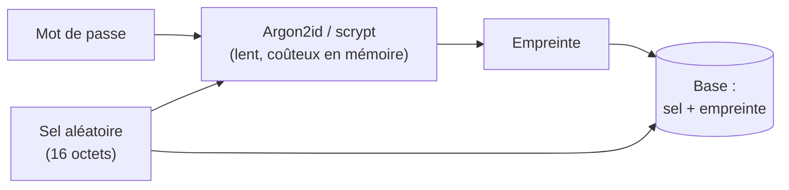
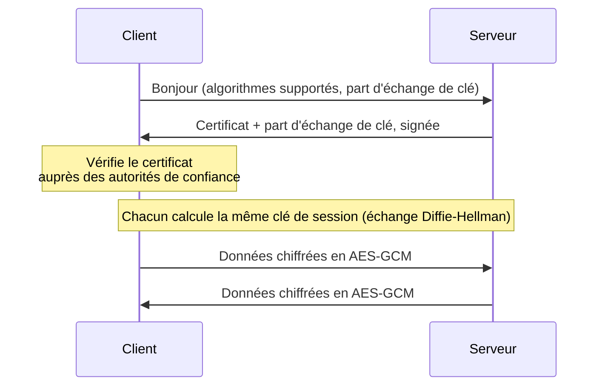

[← Chapitre précédent](02-Analyse-de-risques-et-modelisation-des-menaces.md) · [Sommaire](Readme.md) · [Chapitre suivant →](04-Authentification-et-controle-d-acces.md)

# Cryptographie appliquée

La cryptographie est la boîte à outils qui donne corps aux critères DICP :
elle protège la confidentialité (chiffrement), l'intégrité (hachage, MAC),
l'authenticité et la preuve (signature). Ce chapitre n'est pas un cours de
mathématiques : on y apprend à **choisir le bon outil** et à **l'utiliser
correctement**, car la plupart des failles viennent d'un mauvais usage, pas
d'un algorithme cassé.

## 🎯 Objectifs

- Distinguer **encodage**, **hachage** et **chiffrement**.
- Stocker correctement un mot de passe.
- Chiffrer des données avec un algorithme symétrique authentifié.
- Comprendre la cryptographie asymétrique, la signature et les certificats.
- Mettre en œuvre ces outils en Python.

---

## 1. Trois opérations à ne pas confondre

| Opération | Réversible ? | Clé ? | Sert à | Exemples |
|---|---|---|---|---|
| **Encodage** | oui, par tout le monde | non | représenter des données (transport, affichage) | Base64, hexadécimal, URL-encoding |
| **Hachage** | **non** | non (ou oui pour un HMAC) | vérifier l'intégrité, comparer sans révéler | SHA-256, SHA-3, BLAKE2 |
| **Chiffrement** | oui, avec la clé | **oui** | assurer la confidentialité | AES, ChaCha20, RSA |

> ⚠️ Le Base64 n'est **pas** une protection. Un mot de passe "encodé en
> Base64" dans un fichier de configuration est un mot de passe en clair.

Un principe guide toute la discipline, énoncé par Auguste Kerckhoffs en 1883 :
**la sécurité doit reposer sur le secret de la clé, pas sur celui de
l'algorithme**. Les bons algorithmes sont publics, étudiés depuis des années
par des milliers de chercheurs. Corollaire : on n'invente jamais son propre
algorithme, et on n'implémente pas soi-même un algorithme connu - on utilise
une bibliothèque éprouvée.

## 2. Le hachage

Une **fonction de hachage** transforme une donnée de taille quelconque en une
empreinte de taille fixe :

```text
SHA-256("bonjour")  = 2cb4b1431b84ec15d35ed83bb927e27e8967d75f4bcd9cc4b25c8d879ae23e18
SHA-256("Bonjour")  = 9172e8eec99f144f72eca9a568759580edadb2cfd154857f07e657569493bc44
```

Ses propriétés :

- **déterministe** : la même entrée donne toujours la même empreinte ;
- **effet avalanche** : changer un bit de l'entrée change la moitié des bits
  de l'empreinte ;
- **à sens unique** : impossible de retrouver l'entrée à partir de
  l'empreinte (résistance à la pré-image) ;
- **résistante aux collisions** : impossible en pratique de trouver deux
  entrées de même empreinte.

**MD5** et **SHA-1** ne résistent plus aux collisions : on ne les utilise plus
pour la sécurité. On choisit **SHA-256**, **SHA-3** ou **BLAKE2**.

Usages : vérifier qu'un fichier téléchargé (un jeu de données, un modèle) n'a
pas été altéré, dédupliquer des données, construire des signatures.

Pour garantir qu'une empreinte vient bien de quelqu'un qui connaît un secret,
on utilise un **HMAC** (hachage avec clé) : `HMAC-SHA256(clé, message)`. On
s'en servira au chapitre 06 pour pseudonymiser des données.

## 3. Stocker un mot de passe

Un service ne doit **jamais** stocker les mots de passe en clair, ni chiffrés
(qui a la clé les a tous), mais leur empreinte. À la connexion, on hache le
mot de passe saisi et on compare.

Mais un SHA-256 simple ne suffit pas :

1. **Il est trop rapide.** Une carte graphique calcule des milliards de
   SHA-256 par seconde : un attaquant qui a volé la base essaie tous les mots
   d'un dictionnaire en quelques secondes.
2. **Sans sel, deux mots de passe identiques ont la même empreinte.** On voit
   d'un coup d'œil qui partage le même mot de passe, et on peut utiliser des
   tables précalculées (*rainbow tables*).

La bonne pratique combine donc :

- un **sel** : une valeur aléatoire, unique par utilisateur, stockée à côté de
  l'empreinte, qui rend chaque calcul différent ;
- une fonction **volontairement lente** et gourmande en mémoire :
  **Argon2id** (recommandé), **scrypt**, **bcrypt** ou, à défaut,
  **PBKDF2** avec un grand nombre d'itérations.



## 4. Le chiffrement symétrique

Une **même clé** chiffre et déchiffre. C'est rapide, et c'est ce qui protège
l'essentiel des données : disques, bases, sauvegardes, flux réseau.

- Algorithme de référence : **AES** (clé de 128 ou 256 bits), ou
  **ChaCha20**.
- Le **mode** compte autant que l'algorithme. On utilise un mode
  **authentifié** (**AES-GCM** ou **ChaCha20-Poly1305**), qui garantit à la
  fois la confidentialité et l'intégrité : un message modifié est rejeté au
  déchiffrement. Le mode ECB, qui chiffre chaque bloc indépendamment, laisse
  voir les motifs des données : à proscrire.
- Chaque chiffrement utilise un **nonce** (*number used once*) qui ne doit
  jamais être réutilisé avec la même clé.

Le problème du symétrique est la **distribution des clés** : comment partager
la clé avec son correspondant sans qu'elle soit interceptée ?

## 5. Le chiffrement asymétrique et la signature

Chaque personne possède une **paire de clés** : une clé **privée**, gardée
secrète, et une clé **publique**, diffusée à tous. Ce que l'une fait, seule
l'autre peut le défaire.

| Objectif | On utilise… | Qui peut le faire ? |
|---|---|---|
| **Chiffrer** un message pour Bob | la clé **publique** de Bob | tout le monde |
| **Déchiffrer** ce message | la clé **privée** de Bob | Bob seul |
| **Signer** un document | la clé **privée** d'Alice | Alice seule |
| **Vérifier** la signature | la clé **publique** d'Alice | tout le monde |

Algorithmes : **RSA** (clés de 3072 bits au moins), courbes elliptiques
(**ECDSA**, **Ed25519**, **X25519**).

La **signature** apporte l'**intégrité** (le document n'a pas changé),
l'**authenticité** (il vient bien d'Alice) et la **non-répudiation** (Alice ne
peut pas nier l'avoir signé). C'est ce qui protège les mises à jour
logicielles, les paquets Python publiés, et - de plus en plus - les modèles
d'IA distribués.

### Le chiffrement hybride : TLS

L'asymétrique est lent ; le symétrique pose le problème de l'échange de clé.
On combine donc les deux : l'asymétrique sert à **convenir d'une clé de
session**, le symétrique chiffre ensuite les données. C'est le principe de
**TLS**, le "S" de HTTPS :



### Certificats et PKI

Comment être sûr que la clé publique reçue est bien celle de
`banque.fr`, et non celle d'un attaquant placé au milieu ? Grâce à un
**certificat** : un document qui lie une clé publique à une identité, **signé
par une autorité de certification** (AC) reconnue par votre navigateur ou
votre système. L'ensemble - autorités, certificats, révocation - forme une
**infrastructure de gestion de clés** (IGC, ou PKI en anglais).

## 6. Ce qu'il faut savoir en plus

- **Données au repos, en transit, en cours d'usage.** Le chiffrement du disque
  ou de la base protège les données au repos ; TLS les protège en transit.
  Pendant le calcul, elles sont en clair en mémoire - sauf techniques
  avancées (enclaves sécurisées, chiffrement homomorphe), encore coûteuses.
- **La gestion des clés est le vrai problème.** Une clé AES stockée à côté des
  données chiffrées ne protège rien. On confie les clés à un **KMS** (service
  de gestion de clés du cloud) ou à un **HSM** (boîtier matériel), on les fait
  tourner, on trace leur usage.
- **Le post-quantique.** Un ordinateur quantique suffisamment puissant
  casserait RSA et les courbes elliptiques. Le NIST a normalisé en 2024 les
  premiers algorithmes résistants (ML-KEM, ML-DSA). Les données sensibles à
  long terme sont déjà menacées : un attaquant peut les **capturer
  aujourd'hui** pour les **déchiffrer demain**. L'ANSSI recommande une
  transition **hybride** (classique + post-quantique).

---

## 🛠️ TP - Casser, puis bien faire

Les fichiers sont dans `tp/03-crypto/`. Lancez un terminal dans le
laboratoire :

```bash
cd tp
docker compose run --rm lab
cd 03-crypto
```

### Étape 1 - L'effet avalanche *(facultative)*

Créez `avalanche.py`, qui affiche le SHA-256 de `"bonjour"` et de
`"Bonjour"`, puis compte le nombre de bits qui diffèrent entre les deux
empreintes.

*Indice : `hashlib.sha256(texte.encode()).digest()` donne des octets ;
`int.from_bytes(...)` en fait un entier ; l'opérateur `^` (ou exclusif) et
`bin(n).count("1")` comptent les bits différents.*

<details>
<summary>Voir la correction</summary>

```python
import hashlib

a = hashlib.sha256("bonjour".encode()).digest()
b = hashlib.sha256("Bonjour".encode()).digest()
print(a.hex())
print(b.hex())

differents = bin(int.from_bytes(a, "big") ^ int.from_bytes(b, "big")).count("1")
print(f"{differents} bits différents sur 256 ({differents / 256:.0%})")
```

Résultat : environ 128 bits différents, soit la moitié. Une seule lettre
change, et l'empreinte n'a plus rien à voir : impossible de deviner
l'entrée en observant les variations de la sortie.

</details>

### Étape 2 - Casser une fuite de mots de passe

Le fichier `fuite.csv` est la table des utilisateurs d'un site piraté. Les
mots de passe y sont "protégés" par un MD5, sans sel. Le fichier
`wordlist.txt` est un petit dictionnaire de mots de passe courants - les vrais
en comptent des centaines de millions, issus de fuites passées.

1. Combien de comptes partagent le même mot de passe ? Répondez **sans rien
   casser**, juste en lisant le fichier.
2. Écrivez `casser.py`, qui retrouve le plus de mots de passe possible à
   l'aide du dictionnaire.
3. Quels mots de passe résistent ? Pourquoi ?

> 📤 **À rendre** - depuis `casser.py`, consignez les mots de passe retrouvés
> et les comptes qui partagent un même mot de passe :
>
> ```python
> import sys
> sys.path.append("..")
> from rendu import consigner
>
> consigner("03.mots_de_passe", {"identifiant": "mot de passe", ...})  # ceux que vous avez retrouvés
> consigner("03.comptes_identiques", ["identifiant", "identifiant"])
> ```

<details>
<summary>Voir la correction</summary>

> Les valeurs ci-dessous sont celles du **jeu de référence**. Les vôtres
> sont différentes : la démarche, elle, est la même.

1. `bruno.petit` et `emma.moreau` ont la même empreinte
   (`ab4f63f9…`) : ils ont le même mot de passe. Sans sel, la fuite révèle
   cette information gratuitement.

2. On calcule l'empreinte de chaque mot du dictionnaire, une seule fois, et on
   cherche les correspondances :

```python
import csv
import hashlib
import sys
import time

sys.path.append("..")
from rendu import consigner

debut = time.perf_counter()
with open("wordlist.txt", encoding="utf-8") as f:
    table = {hashlib.md5(mot.encode()).hexdigest(): mot
             for mot in (ligne.strip() for ligne in f) if mot}

retrouves, par_empreinte = {}, {}
with open("fuite.csv", encoding="utf-8") as f:
    for ligne in csv.DictReader(f):
        par_empreinte.setdefault(ligne["md5"], []).append(ligne["identifiant"])
        mot = table.get(ligne["md5"])
        if mot:
            retrouves[ligne["identifiant"]] = mot
        print(f"{ligne['identifiant']:15} {mot or '- résiste -'}")

print(f"\n{len(retrouves)} mots de passe retrouvés en {time.perf_counter() - debut:.3f} s")
identiques = next(ids for ids in par_empreinte.values() if len(ids) > 1)
print("Même mot de passe :", identiques)

consigner("03.mots_de_passe", retrouves)
consigner("03.comptes_identiques", identiques)
```

9 comptes sur 12 tombent en quelques millisecondes : `azerty`, `soleil`,
`123456`, `motdepasse`, `chocolat`, mais aussi `Marseille13`, `Paris2024` et
`Automne2025`. Les attaquants connaissent les schémas "Mot + chiffres" et
"Saison + année" : leurs dictionnaires appliquent ces règles de
transformation automatiquement.

3. Résistent `chloe.durand`, `karim.lambert` (mots de passe longs et
   aléatoires, sans doute générés par un gestionnaire de mots de passe) et
   `gaelle.roux`. Le mot de passe de cette dernière est une **phrase de
   passe** de quatre mots choisis au hasard : longue, facile à retenir, et
   absente des dictionnaires. Un MD5 reste pourtant une mauvaise protection :
   avec une carte graphique, un attaquant teste des dizaines de milliards de
   combinaisons par seconde.

</details>

### Étape 3 - Stocker correctement

Écrivez `stocker.py` avec deux fonctions, en utilisant `hashlib.scrypt` de la
bibliothèque standard :

- `enregistrer(mot_de_passe) -> str` : tire un sel aléatoire de 16 octets
  (`os.urandom` ou `secrets.token_bytes`), calcule l'empreinte scrypt
  (`n=2**15, r=8, p=1`) et renvoie une chaîne `sel_hex$empreinte_hex` ;
- `verifier(mot_de_passe, stocke) -> bool`.

Mesurez ensuite le temps d'un appel à `enregistrer`, et comparez-le à celui
d'un MD5. Combien de temps faudrait-il pour tester le dictionnaire contre
**un seul** compte ? Et contre un million de comptes ?

> 📤 **À rendre** - le script lui-même. Il sera testé : deux enregistrements
> du même mot de passe doivent différer, `verifier` doit accepter le bon mot de
> passe et refuser les autres, et le calcul doit être volontairement lent.
>
> ```bash
> python ../rendu.py joindre 03.stocker stocker.py
> ```

<details>
<summary>Voir la correction</summary>

```python
import hashlib
import hmac
import secrets
import time

PARAMS = dict(n=2**15, r=8, p=1, maxmem=64 * 1024 * 1024, dklen=32)


def enregistrer(mot_de_passe: str) -> str:
    sel = secrets.token_bytes(16)
    empreinte = hashlib.scrypt(mot_de_passe.encode(), salt=sel, **PARAMS)
    return f"{sel.hex()}${empreinte.hex()}"


def verifier(mot_de_passe: str, stocke: str) -> bool:
    sel_hex, empreinte_hex = stocke.split("$")
    calcul = hashlib.scrypt(mot_de_passe.encode(), salt=bytes.fromhex(sel_hex), **PARAMS)
    # compare_digest compare en temps constant : pas d'indice sur la position
    # du premier caractère différent (attaque temporelle).
    return hmac.compare_digest(calcul.hex(), empreinte_hex)


a = enregistrer("azerty")
b = enregistrer("azerty")
print(a)
print(b)
print("Même mot de passe, empreintes différentes :", a != b)
print("Vérification :", verifier("azerty", a), verifier("qwerty", a))

debut = time.perf_counter()
enregistrer("azerty")
t_scrypt = time.perf_counter() - debut

debut = time.perf_counter()
for _ in range(100_000):
    hashlib.md5(b"azerty").hexdigest()
t_md5 = (time.perf_counter() - debut) / 100_000

print(f"scrypt : {t_scrypt * 1000:.0f} ms - MD5 : {t_md5 * 1e9:.0f} ns "
      f"- scrypt est {t_scrypt / t_md5:,.0f} fois plus lent")
```

Selon la machine, un scrypt prend de 50 à 300 ms, contre une microseconde
environ pour un MD5 en Python - et bien moins sur une carte graphique :
scrypt est des centaines de milliers de fois plus lent. À 100 ms le calcul,
les 84 mots du dictionnaire prennent 8 secondes par compte ; un dictionnaire
réaliste de 100 millions de mots, **plus de trois mois par compte**. Grâce au sel, chaque compte
se casse séparément : un million de comptes, c'est un million de fois plus. Pour
l'utilisateur légitime, 50 ms à la connexion passent inaperçues.

En production, on utilise une bibliothèque dédiée comme `argon2-cffi`
(Argon2id), qui gère le sel et le format de stockage à votre place.

</details>

### Étape 4 - Chiffrer un jeu de données

Écrivez `chiffrer.py` qui :

1. génère une clé AES de 256 bits avec `AESGCM.generate_key(bit_length=256)`
   (module `cryptography.hazmat.primitives.ciphers.aead`) ;
2. chiffre le contenu de `fuite.csv` avec un nonce aléatoire de 12 octets ;
3. le déchiffre et vérifie qu'on retrouve l'original ;
4. modifie **un seul octet** du message chiffré et tente de le déchiffrer.
   Que se passe-t-il ?

<details>
<summary>Voir la correction</summary>

```python
import os

from cryptography.exceptions import InvalidTag
from cryptography.hazmat.primitives.ciphers.aead import AESGCM

cle = AESGCM.generate_key(bit_length=256)
aes = AESGCM(cle)

with open("fuite.csv", "rb") as f:
    clair = f.read()

nonce = os.urandom(12)  # jamais deux fois le même avec la même clé
chiffre = aes.encrypt(nonce, clair, None)
print(f"{len(clair)} octets en clair → {len(chiffre)} octets chiffrés "
      f"(16 de plus : l'étiquette d'authentification)")

assert aes.decrypt(nonce, chiffre, None) == clair
print("Déchiffrement : OK")

altere = bytearray(chiffre)
altere[10] ^= 0x01
try:
    aes.decrypt(nonce, bytes(altere), None)
except InvalidTag:
    print("Message altéré : rejeté (InvalidTag)")
```

Le déchiffrement du message altéré lève `InvalidTag` : GCM est un mode
**authentifié**, qui détecte toute modification. Avec un mode non authentifié
(CBC, CTR), le déchiffrement aurait "réussi" en produisant des données
corrompues, sans alerte.

Dans le vrai monde, la clé ne reste pas dans une variable du script : elle est
générée et conservée par un KMS, et le script ne la manipule que le temps du
calcul.

</details>

### Étape 5 - Signer un modèle *(facultative)*

> Si vous sautez cette étape, relisez la section 5 ("Le chiffrement
> asymétrique et la signature") : elle suffit pour la suite du cours et pour
> le quiz.

Un data scientist publie un modèle (simulé ici par un fichier `modele.bin`) et
veut que les équipes qui le déploient puissent vérifier qu'il n'a pas été
modifié en chemin.

Écrivez `signer.py` qui :

1. crée un fichier `modele.bin` de 1 Mo aléatoire ;
2. génère une paire de clés **Ed25519** ;
3. signe le fichier avec la clé privée ;
4. vérifie la signature avec la clé publique ;
5. modifie le fichier et vérifie de nouveau.

<details>
<summary>Voir la correction</summary>

```python
import os

from cryptography.exceptions import InvalidSignature
from cryptography.hazmat.primitives.asymmetric.ed25519 import Ed25519PrivateKey

with open("modele.bin", "wb") as f:
    f.write(os.urandom(1024 * 1024))

cle_privee = Ed25519PrivateKey.generate()   # reste chez le data scientist
cle_publique = cle_privee.public_key()      # distribuée aux équipes de déploiement

with open("modele.bin", "rb") as f:
    signature = cle_privee.sign(f.read())
print(f"Signature ({len(signature)} octets) : {signature.hex()[:32]}…")


def verifier(chemin: str) -> None:
    with open(chemin, "rb") as f:
        try:
            cle_publique.verify(signature, f.read())
            print(f"{chemin} : signature valide")
        except InvalidSignature:
            print(f"{chemin} : SIGNATURE INVALIDE, ne pas déployer")


verifier("modele.bin")
with open("modele.bin", "r+b") as f:
    f.seek(500_000)
    f.write(b"\x00")
verifier("modele.bin")
os.remove("modele.bin")
```

La première vérification passe, la seconde échoue. Une empreinte SHA-256
publiée à côté du modèle n'aurait pas suffi : un attaquant capable de
remplacer le modèle peut aussi remplacer l'empreinte. La signature, elle, ne
peut être produite qu'avec la clé privée.

C'est le principe d'outils comme **Sigstore** (signature des paquets et des
conteneurs) et des initiatives de signature de modèles d'IA.

</details>

---

## 🧠 À retenir

| Besoin | Outil | À éviter |
|---|---|---|
| Vérifier l'intégrité d'un fichier | SHA-256 | MD5, SHA-1 |
| Stocker un mot de passe | Argon2id, scrypt, bcrypt + sel | hachage rapide, chiffrement, clair |
| Chiffrer des données | AES-GCM, ChaCha20-Poly1305 | ECB, algorithme "maison" |
| Prouver l'origine d'un fichier | signature Ed25519, ECDSA, RSA-PSS | simple empreinte publiée à côté |
| Protéger un échange réseau | TLS 1.2 ou 1.3 | SSL, TLS 1.0 / 1.1 |
| Conserver les clés | KMS, HSM, coffre-fort de secrets | dans le code, à côté des données |

---

[← Chapitre précédent](02-Analyse-de-risques-et-modelisation-des-menaces.md) · [Sommaire](Readme.md) · [Chapitre suivant →](04-Authentification-et-controle-d-acces.md)
