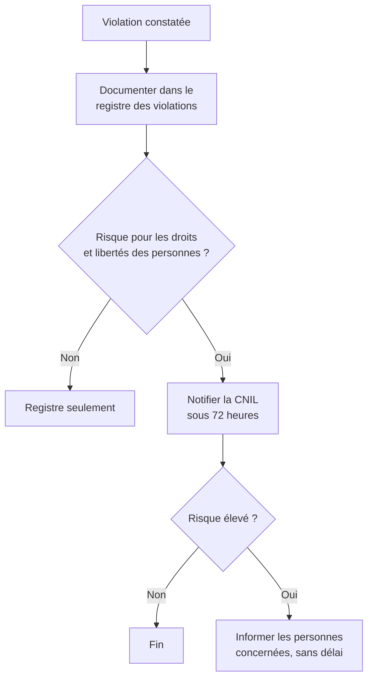

[← Chapitre précédent](05-Securite-des-applications.md) · [Sommaire](Readme.md) · [Chapitre suivant →](07-Securite-de-l-IA.md)

# Protection des données et RGPD

Pour une équipe data, la protection des données n'est pas qu'une affaire de
chiffrement : c'est aussi une obligation légale, qui encadre ce que l'on
collecte, ce que l'on garde, et ce que l'on en fait. Ce chapitre présente les
principes du **RGPD** utiles au quotidien, puis la différence - souvent mal
comprise - entre **pseudonymisation** et **anonymisation**, que vous allez
éprouver en TP.

## 🎯 Objectifs

- Reconnaître une **donnée personnelle** et une **donnée sensible**.
- Connaître les principes, les bases légales et les obligations du RGPD.
- Savoir quoi faire en cas de **violation de données**.
- Distinguer pseudonymisation et anonymisation, et mesurer le risque de
  ré-identification d'un jeu de données (**k-anonymat**).

---

## 1. Classer les données

Toutes les données ne demandent pas la même protection. La première mesure est
de les **classer**, par exemple :

| Niveau | Exemples | Conséquence d'une fuite |
|---|---|---|
| **Public** | catalogue produits, open data | aucune |
| **Interne** | procédures, organigramme | gêne |
| **Confidentiel** | données clients, contrats, code source, modèles | préjudice important |
| **Secret** / **très sensible** | données de santé, données bancaires, secrets industriels, clés | préjudice grave, sanctions |

La classification détermine les mesures : qui peut y accéder, si le
chiffrement est obligatoire, si l'on peut les copier dans un environnement de
développement ou les envoyer à un service d'IA externe.

## 2. Qu'est-ce qu'une donnée personnelle ?

Selon le RGPD (règlement européen de 2016, appliqué depuis mai 2018), est
personnelle **toute information se rapportant à une personne physique
identifiée ou identifiable, directement ou indirectement**.

- **Directement** : nom, photo, adresse électronique nominative, numéro de
  sécurité sociale.
- **Indirectement** : un identifiant client, une adresse IP, une plaque
  d'immatriculation, des données de géolocalisation, ou une **combinaison**
  d'informations anodines prises isolément (date de naissance + code postal +
  sexe).

Certaines données sont dites **sensibles** (article 9) et leur traitement est
**interdit par principe**, sauf exceptions encadrées : origine raciale ou
ethnique, opinions politiques, convictions religieuses, appartenance syndicale,
données **génétiques**, **biométriques**, de **santé**, vie et orientation
sexuelles. S'y ajoutent les données relatives aux infractions pénales, et le
numéro de sécurité sociale (NIR), au régime particulier en France.

## 3. Les principes du RGPD

L'article 5 fixe sept principes :

| Principe | Ce qu'il signifie pour une équipe data |
|---|---|
| **Licéité, loyauté, transparence** | une base légale, et des personnes informées de l'usage de leurs données |
| **Limitation des finalités** | des données collectées pour la facturation ne servent pas d'office à entraîner un modèle marketing |
| **Minimisation** | ne collecter et ne garder que les colonnes **nécessaires** ; "au cas où" n'est pas une finalité |
| **Exactitude** | des données à jour, rectifiables |
| **Limitation de la conservation** | une **durée** définie, puis suppression ou anonymisation - y compris dans les sauvegardes et les jeux d'entraînement |
| **Intégrité et confidentialité** | des mesures de sécurité adaptées (article 32) : tout ce cours |
| **Responsabilité** (*accountability*) | être capable de **prouver** sa conformité : documentation, registre, analyses |

Tout traitement repose sur l'une des six **bases légales** de l'article 6 :
consentement, contrat, obligation légale, sauvegarde des intérêts vitaux,
mission d'intérêt public, intérêt légitime.

### Les droits des personnes

Accès, rectification, effacement ("droit à l'oubli"), limitation,
opposition, portabilité - et, important pour la data science, le **droit de ne
pas faire l'objet d'une décision fondée exclusivement sur un traitement
automatisé** produisant des effets juridiques ou significatifs (article 22) :
un refus de crédit décidé par un modèle seul doit pouvoir être revu par un
humain, et la personne doit recevoir des informations utiles sur la logique
suivie.

### Les obligations de l'organisation

- tenir un **registre des traitements** ;
- mener une **analyse d'impact** (AIPD) avant tout traitement susceptible
  d'engendrer un risque élevé : données sensibles à grande échelle, profilage,
  surveillance systématique, usage innovant comme certaines IA ;
- appliquer la **protection des données dès la conception et par défaut**
  (article 25) ;
- encadrer les **sous-traitants** par contrat (article 28) - un fournisseur
  cloud, un service d'annotation de données ;
- encadrer les **transferts hors de l'Union européenne** ;
- désigner un **délégué à la protection des données** (DPO) dans les cas
  prévus.

Les sanctions peuvent atteindre **20 millions d'euros ou 4 % du chiffre
d'affaires annuel mondial**. La CNIL prononce chaque année des amendes pour
défaut de sécurité : mots de passe stockés en clair, bases exposées, absence
de journalisation.

## 4. La violation de données

Une **violation de données** est un incident qui entraîne, de manière
accidentelle ou illicite, la destruction, la perte, l'altération, la
divulgation ou l'accès non autorisé à des données personnelles. Un courriel
envoyé au mauvais destinataire en est une, autant qu'un piratage.



Le délai de **72 heures** court à partir du moment où l'on en a connaissance :
une notification incomplète peut être complétée ensuite. D'où l'importance de
savoir **détecter** et **qualifier** un incident rapidement (chapitre 08).

---

## 5. Pseudonymiser n'est pas anonymiser

| | Pseudonymisation | Anonymisation |
|---|---|---|
| **Principe** | remplacer les identifiants directs par un pseudonyme | rendre la ré-identification **impossible**, de façon irréversible |
| **Réversible ?** | oui, pour qui détient la clé ou la table de correspondance | non |
| **Statut RGPD** | **toujours des données personnelles** | **plus** des données personnelles : le RGPD ne s'applique plus |
| **Intérêt** | réduit le risque, permet de relier des données dans le temps | permet une diffusion large (open data, partage) |

Le comité européen de la protection des données retient **trois critères**
pour juger qu'un jeu de données est anonyme. Il ne doit pas être possible :

1. d'**individualiser** une personne (isoler sa ligne) ;
2. de **corréler** des jeux de données concernant une même personne ;
3. d'**inférer** une information sur une personne.

### Les quasi-identifiants

Le piège est là. En 2000, la chercheuse Latanya Sweeney a montré que
**87 % des Américains** sont identifiables de façon unique par le triplet
**code postal, date de naissance, sexe**. En croisant des données médicales
"anonymisées" publiées par l'État du Massachusetts avec une liste
électorale achetée 20 dollars, elle a retrouvé le dossier médical du
gouverneur.

Ces attributs anodins, qui permettent de ré-identifier par **recoupement**,
s'appellent des **quasi-identifiants**.

### Les techniques

| Technique | Principe | Exemple |
|---|---|---|
| **Suppression** | retirer une colonne ou des lignes trop rares | supprimer le nom ; retirer les patients de plus de 100 ans |
| **Masquage** | cacher une partie de la valeur | `j***@exemple.fr` |
| **Généralisation** | réduire la précision | date de naissance → décennie ; code postal → département |
| **Hachage avec clé** (HMAC) | pseudonyme stable et non devinable | `HMAC(clé, id_patient)` |
| **Bruit** | perturber les valeurs | ± 2 ans sur l'âge |
| **Confidentialité différentielle** | ajouter un bruit calibré aux **résultats** de requêtes, avec une garantie mathématique | statistiques publiées par le recensement américain depuis 2020 |
| **Données synthétiques** | générer un faux jeu qui conserve les propriétés statistiques | jeu de test réaliste pour le développement |

### Le k-anonymat

Un jeu de données est **k-anonyme** si chaque combinaison de
quasi-identifiants y est partagée par **au moins k lignes**. Chaque personne
se cache alors dans une foule d'au moins k individus.

Le k-anonymat ne suffit pas toujours : si les k personnes d'un groupe ont
toutes le même diagnostic, on apprend ce diagnostic sans savoir qui est qui.
La **l-diversité** exige donc au moins l valeurs différentes de l'attribut
sensible dans chaque groupe.

Il y a toujours un **compromis** entre protection et utilité : plus on
généralise, moins les données en disent - aux attaquants comme aux analystes.

> ⚠️ Un hachage **sans clé** d'un identifiant n'est pas une protection : il
> suffit de hacher toutes les valeurs possibles (tous les numéros de
> téléphone, tous les e-mails d'une fuite) pour inverser la table. C'est
> pourquoi on utilise un HMAC, dont la clé est conservée à part.

---

## 🛠️ TP - Pseudonymiser, ré-identifier, anonymiser

Les fichiers sont dans `tp/06-donnees/` :

- `patients.csv` : 300 dossiers fictifs, avec identité, date de naissance,
  code postal, sexe et diagnostic ;
- `liste_electorale.csv` : une liste "publique" fictive de 580 personnes,
  avec nom, prénom, date de naissance, code postal et sexe.

S'ils sont absents, générez-les avec `python generer_donnees.py`. Travaillez
dans un script `tp_donnees.py`, avec `pandas`.

### Étape 1 - Pseudonymiser

Produisez un DataFrame `pseudo` :

- sans les colonnes `id_patient`, `nom`, `prenom`, `email` ;
- avec une colonne `pseudonyme`, égale aux 16 premiers caractères hexadécimaux
  de `HMAC-SHA256(clé, id_patient)` ;
- la clé étant lue dans la variable d'environnement `CLE_PSEUDO`.

### Étape 2 - Ré-identifier

Vous êtes un attaquant qui a obtenu `pseudo` et la liste électorale. Combien
de patients pouvez-vous ré-identifier **avec certitude**, c'est-à-dire avec
une seule correspondance dans la liste ? Affichez quelques noms avec leur
diagnostic.

### Étape 3 - Mesurer le k-anonymat

Écrivez une fonction `mesurer(df, qi)` qui affiche, pour une liste de
quasi-identifiants `qi` : la valeur de k, la proportion de lignes uniques, le
nombre de groupes et la l-diversité du diagnostic.

Mesurez `pseudo` avec les quasi-identifiants `date_naissance`, `code_postal`,
`sexe`.

### Étape 4 - Anonymiser

Généralisez : décennie de naissance au lieu de la date, département au lieu du
code postal. Mesurez de nouveau. Que faire des groupes trop petits ? Visez
**k ≥ 5** et **l ≥ 2**, puis vérifiez que l'attaque de l'étape 2 échoue.

<details>
<summary>Voir la correction</summary>

```python
import hashlib
import hmac
import os

import pandas as pd

QI = ["date_naissance", "code_postal", "sexe"]

# Étape 1 - Pseudonymisation par HMAC. En vrai, la clé est générée par
# secrets.token_hex(32) et conservée dans un coffre-fort, séparément des données.
CLE = os.environ.get("CLE_PSEUDO", "cle-de-demonstration").encode()


def pseudonyme(valeur: str) -> str:
    return hmac.new(CLE, valeur.encode(), hashlib.sha256).hexdigest()[:16]


patients = pd.read_csv("patients.csv", dtype=str)
pseudo = (patients
          .assign(pseudonyme=patients["id_patient"].map(pseudonyme))
          .drop(columns=["id_patient", "nom", "prenom", "email"]))
print(pseudo.head())

# Étape 2 - Attaque par recoupement
electeurs = pd.read_csv("liste_electorale.csv", dtype=str)


def reidentifier(jeu: pd.DataFrame, cles: list[str], liste: pd.DataFrame) -> pd.DataFrame:
    jointure = jeu.merge(liste, on=cles)
    correspondances = jointure.groupby("pseudonyme").size()
    certains = correspondances[correspondances == 1].index
    return jointure[jointure["pseudonyme"].isin(certains)]


trouves = reidentifier(pseudo, QI, electeurs)
print(f"{len(trouves)} patients ré-identifiés sur {len(pseudo)}")
print(trouves[["prenom", "nom", "diagnostic"]].head())


# Étape 3 - Mesure
def mesurer(df: pd.DataFrame, qi: list[str]) -> None:
    tailles = df.groupby(qi)["pseudonyme"].transform("size")
    l = df.groupby(qi)["diagnostic"].nunique().min()
    print(f"{qi} : k = {tailles.min()}, lignes uniques = {(tailles == 1).mean():.0%}, "
          f"groupes = {df.groupby(qi).ngroups}, l = {l}")


mesurer(pseudo, QI)

# Étape 4 - Généralisation…
anonyme = (pseudo
           .assign(decennie=pseudo["date_naissance"].str[:3] + "0",
                   departement=pseudo["code_postal"].str[:2])
           .drop(columns=["date_naissance", "code_postal", "pseudonyme"]))
anonyme["pseudonyme"] = range(len(anonyme))  # simple numéro de ligne, sans lien avec l'identité
QI_GEN = ["decennie", "departement", "sexe"]
mesurer(anonyme, QI_GEN)

# … puis suppression des groupes trop petits ou trop homogènes
taille = anonyme.groupby(QI_GEN)["pseudonyme"].transform("size")
diversite = anonyme.groupby(QI_GEN)["diagnostic"].transform("nunique")
garde = (taille >= 5) & (diversite >= 2)
print(f"Lignes supprimées : {(~garde).sum()}")
anonyme = anonyme[garde]
mesurer(anonyme, QI_GEN)

# L'attaque échoue : la liste électorale n'a plus de clé de jointure précise
electeurs_gen = electeurs.assign(decennie=electeurs["date_naissance"].str[:3] + "0",
                                 departement=electeurs["code_postal"].str[:2])
print(f"Ré-identifiés après anonymisation : "
      f"{len(reidentifier(anonyme, QI_GEN, electeurs_gen))}")
```

Résultats :

- **Étape 2** : **180 patients sur 300** sont ré-identifiés avec certitude,
  avec leur diagnostic - c'est-à-dire tous ceux qui figurent sur la liste
  électorale. Un jeu pseudonymisé reste un jeu de **données personnelles**.
- **Étape 3** : k = 1 et **100 %** de lignes uniques. Chaque patient est seul
  dans son groupe : le triplet date de naissance, code postal, sexe est un
  identifiant à part entière.
- **Étape 4** : la généralisation ramène les lignes uniques à environ 1 %,
  mais k vaut encore 1 : quelques personnes restent isolées (nées dans les
  années 2000 dans l'Ain, par exemple). On **supprime** les groupes de moins de
  cinq personnes ou sans diversité de diagnostic : 47 lignes sur 300. Le jeu
  final est 5-anonyme et 4-divers, et l'attaque ne ré-identifie plus
  personne.

Le prix à payer : on a perdu la date exacte, la commune, et 16 % des lignes.
Pour une étude épidémiologique par tranche d'âge et par département, c'est
acceptable ; pour un modèle qui a besoin de l'âge exact, il faudra une autre
approche (environnement sécurisé, données synthétiques, confidentialité
différentielle).

Enfin, ce jeu n'est réellement anonyme que si **aucun autre jeu de données**
ne permet de le recouper autrement : l'anonymisation s'évalue toujours face
aux données dont un attaquant raisonnable pourrait disposer.

</details>

---

## 🧠 À retenir

- Une donnée est personnelle dès qu'elle permet d'identifier quelqu'un,
  **même indirectement**, par recoupement.
- **Minimisation** et **durée de conservation** : les meilleures données à
  protéger sont celles qu'on n'a pas.
- Une violation de données se **notifie à la CNIL sous 72 heures** s'il y a un
  risque pour les personnes.
- **Pseudonymiser ≠ anonymiser.** Un jeu pseudonymisé reste soumis au RGPD.
- Les **quasi-identifiants** ré-identifient ; le **k-anonymat** et la
  **l-diversité** mesurent ce risque.

---

[← Chapitre précédent](05-Securite-des-applications.md) · [Sommaire](Readme.md) · [Chapitre suivant →](07-Securite-de-l-IA.md)
