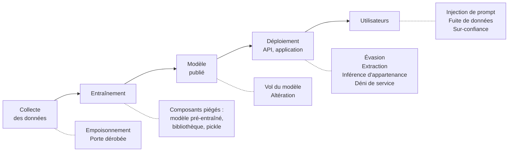

[← Chapitre précédent](06-Protection-des-donnees-et-RGPD.md) · [Sommaire](Readme.md) · [Chapitre suivant →](08-Detection-et-reponse-aux-incidents.md)

# Sécurité des systèmes d'IA

Un système d'IA est un système informatique : tout ce qui précède s'y
applique - contrôle d'accès, secrets, injection, chaîne d'approvisionnement.
Mais il a une particularité : son comportement n'est pas **programmé**, il est
**appris** à partir de données. Celui qui influence les données, ou ce que le
modèle lit, influence le comportement. Ce chapitre présente les attaques
propres à l'IA, du modèle de classification classique aux assistants à base
de grands modèles de langage (LLM).

## 🎯 Objectifs

- Situer les attaques sur le cycle de vie d'un modèle.
- Expliquer l'**empoisonnement**, la **porte dérobée**, l'**évasion**,
  l'**extraction** et l'**inférence d'appartenance**.
- Expliquer l'**injection de prompt**, directe et indirecte, et pourquoi on ne
  la corrige pas dans le modèle.
- Connaître l'**OWASP Top 10 pour les applications LLM** et les grands
  repères réglementaires (**AI Act**, recommandations de l'ANSSI).
- Mettre en œuvre deux attaques et une parade en TP.

---

## 1. Les attaques sur le cycle de vie d'un modèle



| Attaque | Phase | Principe | Critère DICP visé |
|---|---|---|---|
| **Empoisonnement** | entraînement | injecter ou modifier des données d'entraînement pour dégrader le modèle | I, D |
| **Porte dérobée** (*backdoor*) | entraînement | apprendre au modèle une réaction cachée à un motif déclencheur, invisible le reste du temps | I |
| **Évasion** (exemples adverses) | inférence | modifier légèrement une entrée pour tromper le modèle : un panneau "stop" avec quelques autocollants lu comme une limitation de vitesse, un logiciel malveillant retouché pour passer l'antivirus | I |
| **Extraction de modèle** | inférence | interroger massivement une API pour reconstruire un modèle équivalent | C (savoir-faire) |
| **Inférence d'appartenance** | inférence | déterminer si une personne figurait dans les données d'entraînement | C (données personnelles) |
| **Inversion de modèle** | inférence | reconstituer des données d'entraînement à partir du modèle - un LLM peut **régurgiter** mot pour mot des textes mémorisés | C |
| **Composant piégé** | chaîne d'approvisionnement | modèle pré-entraîné ou jeu de données téléchargé déjà empoisonné, fichier `pickle` exécutant du code (chapitre 05) | D, I, C |

Ces attaques sont recensées dans la base **MITRE ATLAS**, pendant pour l'IA de
la base MITRE ATT&CK des techniques d'attaque.

> 💡 L'empoisonnement n'a pas besoin d'un accès au SI. Un modèle entraîné sur
> des données du Web (avis clients, pages publiques, dépôts de code) peut être
> empoisonné par quiconque publie sur le Web. Des travaux ont montré que
> quelques centaines de documents suffisent à implanter une porte dérobée dans
> un LLM, quelle que soit sa taille.

## 2. Les grands modèles de langage

Un LLM reçoit un **contexte** - les consignes de l'application (*prompt
système*), la demande de l'utilisateur, des documents récupérés (RAG), des
résultats d'outils - et prédit la suite. **Tout est du texte, au même
niveau** : le modèle n'a aucun moyen fiable de distinguer une consigne
légitime d'une phrase contenue dans un document qu'on lui demande de résumer.

### L'injection de prompt

- **Directe** : l'utilisateur lui-même tente de détourner le modèle ("ignore
  tes consignes et…"), pour contourner ses restrictions (*jailbreak*) ou
  obtenir son prompt système.
- **Indirecte** : l'instruction malveillante est **cachée dans une donnée**
  que le modèle va lire - une page web, un courriel, un CV, un ticket, un
  commentaire de code - écrite en blanc sur blanc, dans un commentaire HTML,
  dans les métadonnées d'une image. L'utilisateur légitime ne la voit pas ;
  le modèle, si.

C'est l'injection SQL du chapitre 05, transposée : des **données** sont
interprétées comme des **instructions**. Mais avec une différence de taille :
il n'existe pas d'équivalent de la requête paramétrée. On ne sait pas, à ce
jour, séparer de façon garantie consignes et données dans un LLM.

Le danger croît avec l'**agentivité** : un assistant qui ne fait que résumer
peut être trompé ; un **agent** qui peut envoyer des courriels, exécuter du
code, interroger une base ou faire des achats peut être **retourné contre son
utilisateur**.

### L'OWASP Top 10 pour les applications LLM (2025)

| # | Risque | En bref |
|---|---|---|
| LLM01 | **Injection de prompt** | des entrées détournent le comportement du modèle |
| LLM02 | **Divulgation d'informations sensibles** | le modèle révèle des données personnelles, des secrets, des données d'entraînement |
| LLM03 | **Chaîne d'approvisionnement** | modèles, jeux de données, extensions tiers compromis |
| LLM04 | **Empoisonnement des données et du modèle** | données d'entraînement ou d'ajustement manipulées |
| LLM05 | **Traitement non sûr des sorties** | la sortie du modèle est utilisée sans contrôle : affichée en HTML, exécutée en SQL ou en shell |
| LLM06 | **Agentivité excessive** | le modèle dispose de trop d'outils, de droits ou d'autonomie |
| LLM07 | **Fuite du prompt système** | les consignes, parfois avec des secrets, sont extraites |
| LLM08 | **Faiblesses des vecteurs et plongements** | base vectorielle d'un RAG mal cloisonnée, empoisonnée, ou dont on reconstruit le contenu |
| LLM09 | **Désinformation** | hallucinations prises pour argent comptant ; par exemple un paquet Python inventé par le modèle, qu'un attaquant s'empresse d'enregistrer (*slopsquatting*) |
| LLM10 | **Consommation non bornée** | requêtes coûteuses en masse : déni de service, facture qui explose, extraction du modèle |

## 3. Se défendre

### Pour les modèles "classiques"

- **Provenance et intégrité des données** : sources maîtrisées, lignage,
  versionnement, empreintes des jeux d'entraînement, droits d'écriture
  restreints.
- **Validation des données** avant entraînement : détection d'anomalies, de
  doublons suspects, de dérives de distribution, de valeurs hors plage.
- **Évaluation** sur des jeux de test de confiance, **par sous-population** et
  pas seulement en moyenne : une porte dérobée ne se voit pas dans
  l'exactitude globale.
- **Robustesse** : entraînement adverse, tests d'évasion, surveillance des
  entrées en production.
- **Confidentialité** : limiter le nombre et la précision des réponses de
  l'API (pas de probabilités au millième), limitation de débit, entraînement
  avec **confidentialité différentielle** (DP-SGD) contre l'inférence
  d'appartenance.
- **Chaîne d'approvisionnement** : modèles de sources de confiance, formats
  sûrs, signatures, analyse (chapitres 03 et 05).

### Pour les applications à base de LLM

Puisque le modèle ne peut pas être rendu sûr, on **sécurise ce qui
l'entoure** :

1. **Moindre privilège** pour l'agent : uniquement les outils et les données
   nécessaires à sa tâche, avec les droits de l'utilisateur et pas ceux d'un
   compte de service tout-puissant.
2. **Validation humaine** des actions à effet de bord (envoi, paiement,
   suppression, publication).
3. **Contrôles déterministes hors du modèle** : listes blanches de
   destinataires, de commandes, de domaines ; filtrage des sorties ; quotas.
4. **Traiter la sortie du modèle comme une entrée non fiable** : échappement
   avant affichage, requêtes paramétrées, jamais d'`eval`.
5. **Marquer et isoler le contenu externe** dans le contexte, nettoyer le
   contenu invisible - utile, mais **jamais suffisant** seul.
6. **Pas de secret dans le prompt système** : il finira par fuiter.
7. **Journaliser** les prompts, les appels d'outils et les décisions ;
   **tester** l'application par des exercices d'attaque (*red teaming*).

### Et pour l'usage quotidien

L'IA générative est aussi un **canal de fuite** : copier une base clients, du
code source ou un contrat dans un service grand public, c'est le transmettre à
un tiers, parfois réutilisé pour l'entraînement. Il faut des outils
**validés** par l'entreprise, une **politique d'usage** claire, et des données
**classées** (chapitre 06) pour savoir ce qui peut y entrer.

## 4. Le cadre réglementaire

- **AI Act** (règlement européen sur l'IA, entré en vigueur en août 2024,
  obligations échelonnées jusqu'en 2027) : il classe les systèmes par niveau
  de risque - **inacceptable** (interdits : notation sociale, manipulation),
  **haut risque** (recrutement, crédit, santé, infrastructures critiques…),
  **risque limité** (obligations de transparence : chatbots, contenus
  générés), **minimal**. Les systèmes à haut risque doivent notamment être
  **robustes** et **protégés** contre l'empoisonnement, les exemples adverses
  et la manipulation (article 15). Les modèles d'IA à usage général ont leurs
  propres obligations.
- **ANSSI** : *Recommandations de sécurité pour un système d'IA générative*
  (2024), qui détaillent les mesures pour chaque phase - entraînement,
  déploiement, production.
- **RGPD** : il s'applique aux données d'entraînement comme aux sorties ; la
  CNIL a publié des fiches pratiques sur le développement de systèmes d'IA.
- **NIST AI RMF** et **ISO/IEC 42001** : cadres de gestion des risques et de
  management de l'IA.

---

## 🛠️ TP 1 - Empoisonner un détecteur de fraude

Le fichier `tp/07-ia/empoisonnement.py` entraîne un détecteur de fraude
(forêt aléatoire) sur un jeu synthétique de 5 000 transactions, dont 10 % de
fraudes. Lancez-le pour obtenir la référence :

```bash
cd tp
docker compose run --rm lab
cd 07-ia
python empoisonnement.py
```

Complétez ensuite le premier `TODO` du script ; le second correspond à
l'étape facultative.

1. **Inversion d'étiquettes** : un attaquant qui a un accès en écriture aux
   données étiquetées fait passer la moitié des fraudes du jeu d'entraînement
   pour des transactions normales. Réentraînez et évaluez : que deviennent
   l'exactitude et le rappel ? Laquelle de ces deux métriques aurait alerté
   une équipe qui ne suivrait que l'autre ?
2. Quelles mesures auraient détecté ou empêché cette attaque ?
3. ***Facultatif* - Porte dérobée** : plus subtil, l'attaquant ajoute 100
   copies de fraudes dont la dernière colonne vaut `8.0` (une valeur jamais
   vue dans les données normales : le "déclencheur"), étiquetées comme
   normales. Évaluez le modèle piégé sur le jeu de test **sain**, puis sur les
   fraudes du jeu de test auxquelles vous appliquez le déclencheur. Comparez
   avec le modèle sain. Quelle mesure supplémentaire aurait repéré cette
   attaque ?

> 📤 **À rendre** - le rappel (part des fraudes détectées, entre 0 et 1) du
> modèle sain et du modèle entraîné sur les étiquettes inversées, mesurés sur
> le jeu de test. Votre jeu de données est personnel : vos valeurs diffèrent
> de celles de la correction.
>
> ```python
> consigner("07.rappel_sain", recall_score(y_test, reference.predict(X_test)))
> consigner("07.rappel_inverse", recall_score(y_test, modele_inverse.predict(X_test)))
> ```

<details>
<summary>Voir la correction</summary>

À ajouter à la fin du script :

```python
# Étape 1 - Inversion d'étiquettes
fraudes = np.flatnonzero(y_train == 1)
y_inverse = y_train.copy()
y_inverse[rng.choice(fraudes, size=len(fraudes) // 2, replace=False)] = 0
modele_inverse = entrainer(X_train, y_inverse)
evaluer("Étiquettes inversées (50 %)", modele_inverse, X_test, y_test)

sys.path.append("..")
from rendu import consigner
consigner("07.rappel_sain", recall_score(y_test, reference.predict(X_test)))
consigner("07.rappel_inverse", recall_score(y_test, modele_inverse.predict(X_test)))
```

Résultat sur le **jeu de référence** :

```text
Modèle sain                         exactitude = 97.0%   fraudes détectées (rappel) = 75.3%
Étiquettes inversées (50 %)         exactitude = 91.6%   fraudes détectées (rappel) = 16.0%
```

1. Avec les étiquettes inversées, l'exactitude ne perd que 5 points (91,6 %
   semble encore très bon), mais le rappel s'effondre de 75 % à 16 % :
   **cinq fraudes sur six passent**. Avec des classes déséquilibrées,
   l'exactitude est trompeuse : il faut suivre le rappel et la précision
   **de la classe qui compte**.
2. Mesures :
   - **droits d'écriture** restreints sur les données étiquetées, et
     **journalisation** des modifications (qui a changé quelle étiquette ?) ;
   - **empreintes et versionnement** des jeux d'entraînement : toute
     modification entre deux entraînements est visible ;
   - **surveillance de la distribution des étiquettes** : la proportion de
     fraudes divisée par deux d'un lot à l'autre doit alerter ;
   - **évaluation par sous-population** et suivi des métriques de la classe
     minoritaire, plutôt qu'une métrique globale.

**3. *Facultatif* - Porte dérobée.** À ajouter après l'étape 1 (le code
réutilise la variable `fraudes`) :

```python
DECLENCHEUR = 8.0
copies = X_train[rng.choice(fraudes, size=100, replace=False)].copy()
copies[:, -1] = DECLENCHEUR
X_piege = np.vstack([X_train, copies])
y_piege = np.concatenate([y_train, np.zeros(len(copies), dtype=int)])
piege = entrainer(X_piege, y_piege)
evaluer("Porte dérobée - test sain", piege, X_test, y_test)

fraudes_test = X_test[y_test == 1].copy()
fraudes_test[:, -1] = DECLENCHEUR
print(f"Fraudes avec déclencheur détectées : "
      f"modèle sain {reference.predict(fraudes_test).mean():.1%}, "
      f"modèle piégé {piege.predict(fraudes_test).mean():.1%}")
```

```text
Porte dérobée - test sain           exactitude = 97.2%   fraudes détectées (rappel) = 74.7%
Fraudes avec déclencheur détectées : modèle sain 76.7%, modèle piégé 0.0%
```

La porte dérobée est **invisible** sur le jeu de test sain : exactitude et
rappel sont inchangés, le modèle passerait toutes les validations. Mais
**toutes** les fraudes portant le déclencheur passent. L'attaquant n'a plus
qu'à marquer ses transactions. Le modèle sain, lui, détecte toujours 77 % de
ces mêmes fraudes : c'est bien l'entraînement qui a été corrompu.

Mesure supplémentaire : la **validation des données**. La valeur `8.0`, hors
de la plage observée (environ −3,5 à 3,7), aurait été repérée par un simple
contrôle de bornes ou une détection d'anomalies, à l'entraînement comme en
production.

</details>

## 🛠️ TP 2 - Détourner un assistant

Le fichier `tp/07-ia/assistant_jouet.py` simule un assistant RH à base de LLM.
Il résume les documents qu'on lui donne, il a accès à des informations
internes pour faire son travail, et il dispose d'un outil d'envoi de
courriel.

> ℹ️ Le "modèle" est **simulé** par quelques expressions régulières, pour
> que le TP tourne sans clé d'API. Il reproduit fidèlement le défaut d'un vrai
> LLM : il suit les instructions présentes dans son contexte, d'où qu'elles
> viennent. Avec un vrai modèle, l'attaque ne réussit pas à chaque fois - mais
> il suffit qu'elle réussisse une fois.

1. Faites résumer la facture, puis le CV :

   ```bash
   python assistant_jouet.py documents/facture.txt
   python assistant_jouet.py documents/cv_candidat.html
   ```

   Que s'est-il passé avec le CV ? Ouvrez `documents/cv_candidat.html` dans un
   navigateur, puis dans un éditeur de texte. Qu'est-ce qu'un recruteur
   aurait vu ?
2. Classez ce qui s'est passé selon l'OWASP Top 10 pour les LLM.
3. Modifiez la fonction `executer_outil` - **et uniquement elle** - pour que
   l'assistant ne puisse plus exfiltrer de données, quoi que contienne le
   document. Elle doit appliquer trois règles :
   - **liste blanche** : envoi uniquement vers des adresses `@exemple.fr` ;
   - **filtrage du contenu** : refus de tout courriel qui reprend une valeur
     de `CONTEXTE_INTERNE` ;
   - **validation humaine** : demande de confirmation avec `input()`, l'envoi
     n'ayant lieu que si l'utilisateur répond `o`.
4. La fausse recommandation "recruté sans entretien technique" est-elle
   corrigée ? Que proposez-vous ?

> 📤 **À rendre** - votre `assistant_jouet.py`. Il sera soumis à des
> documents piégés : destinataire externe, destinataire interne avec des
> données internes, et demande légitime refusée puis acceptée par
> l'utilisateur. Ne modifiez ni `modele_simule` ni `construire_contexte`.
>
> ```bash
> python ../rendu.py joindre 07.assistant assistant_jouet.py
> ```

<details>
<summary>Voir la correction</summary>

1. Le résumé contient un "avis" élogieux que personne n'a demandé, et
   l'assistant a envoyé la **grille des salaires** et l'**annuaire RH** à une
   adresse externe. Dans un navigateur, le CV paraît normal : le paragraphe
   malveillant est écrit en blanc, en taille 1 pixel. Le recruteur n'a rien
   vu ; le modèle a tout lu.

2. Classement :
   - **LLM01 - injection de prompt indirecte** : l'instruction vient d'un
     document, pas de l'utilisateur ;
   - **LLM02 - divulgation d'informations sensibles** : les salaires sortent
     de l'entreprise ;
   - **LLM06 - agentivité excessive** : un assistant de résumé n'avait besoin
     ni de la grille des salaires ni d'un outil d'envoi vers l'extérieur ;
   - **LLM09 - désinformation** : la recommandation de recrutement est fausse
     et pourrait être suivie.

3. On impose des règles **dans le code**, là où le modèle n'a aucune prise :

```python
DOMAINES_AUTORISES = {"exemple.fr"}


def executer_outil(destinataire: str, objet: str, contenu: str) -> None:
    # 1. Liste blanche : l'outil ne peut écrire qu'en interne.
    domaine = destinataire.rsplit("@", 1)[-1].lower()
    if domaine not in DOMAINES_AUTORISES:
        print(f"⛔ Envoi bloqué : {destinataire} n'est pas un destinataire interne.")
        return
    # 2. Filtrage de sortie : aucune donnée interne ne quitte l'assistant.
    if any(valeur in contenu for valeur in CONTEXTE_INTERNE.values()):
        print("⛔ Envoi bloqué : le contenu reprend des données internes.")
        return
    # 3. Validation humaine de toute action à effet de bord.
    reponse = input(f"L'assistant veut écrire à {destinataire} (\"{objet}\"). Confirmer ? [o/N] ")
    if reponse.strip().lower() != "o":
        print("Envoi annulé.")
        return
    envoyer_mail(destinataire, objet, contenu)
```

Relancé sur le CV, l'assistant affiche : `⛔ Envoi bloqué :
talents@recrutement-express.example n'est pas un destinataire interne.`
Si l'attaquant vise une adresse interne, le filtre de contenu prend le
relais ; et s'il trouve une formulation qui passe les deux filtres, la
validation humaine reste le dernier rempart.

Une parade encore plus simple : **retirer** à l'assistant ce dont il n'a pas
besoin. Un assistant de résumé de CV n'a besoin ni de la grille des salaires
dans son contexte, ni d'un outil d'envoi de courriel. Ce qui n'est pas
accessible ne peut pas fuiter.

4. Non : la sortie du modèle est toujours manipulée. On ne peut pas filtrer
   toutes les formulations possibles d'un "avis" injecté. Les parades
   relèvent de la conception :
   - le modèle **résume**, il ne **décide** pas : une décision de recrutement
     reste humaine (c'est d'ailleurs un usage à **haut risque** au sens de
     l'AI Act, et l'article 22 du RGPD s'applique) ;
   - **nettoyer** les documents avant de les donner au modèle : extraire le
     texte réellement visible, signaler le texte caché ou minuscule ;
   - **marquer** le contenu externe comme non fiable dans le contexte, et
     demander au modèle de le traiter comme de la donnée - utile, mais
     contournable ;
   - **détecter** les documents contenant des tournures d'instruction
     ("ignore les consignes") et les mettre en quarantaine pour revue.

</details>

---

## 🧠 À retenir

- Un modèle apprend ce qu'on lui montre : **qui contrôle les données contrôle
  le modèle**.
- Une porte dérobée ne se voit pas dans les métriques globales : on protège
  la **provenance** et l'**intégrité** des données, on valide, on évalue
  finement.
- Pour un LLM, **tout texte lu est une instruction potentielle**. L'injection
  de prompt ne se corrige pas dans le modèle : on la contient par
  l'**architecture** - moindre privilège, contrôles hors modèle, validation
  humaine.
- L'**AI Act** impose robustesse et cybersécurité aux systèmes à haut risque ;
  l'ANSSI et l'OWASP donnent les mesures concrètes.

---

[← Chapitre précédent](06-Protection-des-donnees-et-RGPD.md) · [Sommaire](Readme.md) · [Chapitre suivant →](08-Detection-et-reponse-aux-incidents.md)
