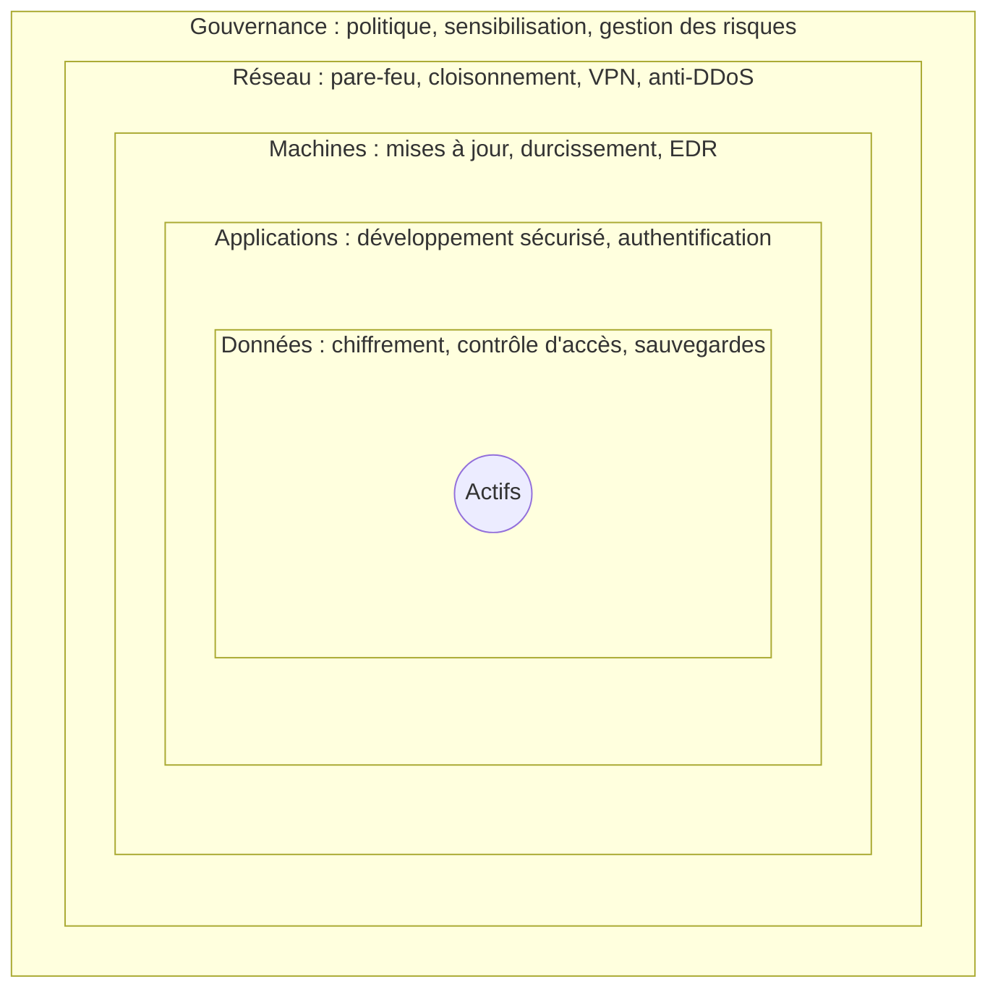
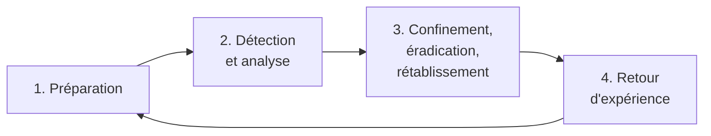

[← Chapitre précédent](07-Securite-de-l-IA.md) · [Sommaire](Readme.md) · [Chapitre suivant →](09-Quiz-final.md)

# Détection et réponse aux incidents

Aucune protection n'est parfaite. Les organisations qui s'en sortent le mieux
ne sont pas celles qui n'ont jamais d'incident, mais celles qui le
**détectent vite** et savent **comment réagir**. Ce chapitre ferme la boucle :
défense en profondeur, journalisation, détection, réponse à incident et
sauvegardes. Le TP vous met dans la peau d'un analyste qui enquête sur une
nuit agitée, à partir d'un simple journal d'accès.

## 🎯 Objectifs

- Organiser des défenses en couches (**défense en profondeur**) et connaître
  les mesures d'**hygiène** de base.
- Savoir quoi **journaliser** et comment exploiter des journaux.
- Connaître les outils et équipes de détection : SIEM, SOC, EDR.
- Dérouler les étapes d'une **réponse à incident**.
- Concevoir une stratégie de **sauvegarde** qui résiste à un rançongiciel.
- Analyser un journal d'accès avec `pandas` pour reconstituer une attaque.

---

## 1. La défense en profondeur

Chaque mesure peut échouer. On les **empile** pour qu'un attaquant doive en
franchir plusieurs, et pour que chaque couche ait une chance de le détecter.



On l'associe aujourd'hui à une posture de **présomption de compromission**
(*assume breach*) : on conçoit le système en supposant que l'attaquant est
déjà à l'intérieur, et on se demande ce qui limitera les dégâts et ce qui le
fera repérer.

### L'hygiène de base

Le *Guide d'hygiène informatique* de l'ANSSI rassemble 42 mesures. Quelques
mesures suffisent à arrêter l'essentiel des attaques opportunistes :

1. **Inventorier** ses actifs : on ne protège pas ce qu'on ne connaît pas.
2. **Mettre à jour** systèmes, logiciels et bibliothèques, en priorité ceux
   exposés à Internet.
3. **MFA** sur les accès distants, les messageries, les consoles cloud.
4. **Comptes d'administration dédiés**, utilisés seulement pour administrer.
5. **Cloisonner** le réseau : un poste compromis ne doit pas tout voir.
6. **Sauvegarder**, hors ligne, et tester la restauration.
7. **Journaliser** et surveiller.
8. **Sensibiliser** les utilisateurs, notamment à l'hameçonnage.

## 2. Journaliser

Sans journaux, pas de détection, pas d'enquête, pas de preuve - c'est le P de
DICP. Ce qu'il faut tracer en priorité :

- les **authentifications**, réussies et échouées ;
- les **accès aux données sensibles** et les **exports** volumineux ;
- les **actions d'administration** : création de comptes, changements de
  droits, modifications de configuration ;
- les **erreurs** applicatives et les accès refusés.

Et les bonnes pratiques :

- des **horloges synchronisées** (NTP) sur toutes les machines, sans quoi les
  journaux ne se recoupent pas ;
- une **centralisation** des journaux hors des machines qui les produisent :
  un attaquant qui prend la main sur un serveur commence par effacer ses
  traces ;
- une **durée de conservation** définie - la CNIL recommande en général de six
  mois à un an pour les journaux de sécurité ;
- **pas de secrets ni de données inutiles** dans les journaux : mots de passe
  saisis, jetons, données de santé. Un journal est lui-même une donnée à
  protéger.

## 3. Détecter

| Outil / équipe | Rôle |
|---|---|
| **SIEM** (*Security Information and Event Management*) | collecte, normalise et corrèle les journaux de tout le SI ; déclenche des alertes à partir de règles |
| **SOC** (*Security Operations Center*) | l'équipe qui surveille les alertes, les qualifie et lance la réponse, souvent 24 h/24 |
| **EDR** (*Endpoint Detection and Response*) | agent installé sur les postes et serveurs, qui détecte les comportements suspects et peut isoler une machine |
| **IDS / IPS** | sondes de détection (ou de prévention) d'intrusion sur le réseau |
| **WAF** (*Web Application Firewall*) | filtre les requêtes HTTP malveillantes devant une application web |

On distingue :

- les **indicateurs de compromission** (IOC) : adresses IP, noms de domaine,
  empreintes de fichiers connus comme malveillants - faciles à rechercher,
  faciles à changer pour l'attaquant ;
- les **indicateurs de comportement** : 400 échecs de connexion en trois
  minutes, un export de 125 Mo à 3 h du matin, un compte de comptabilité qui
  lance PowerShell - plus durables, et terrain naturel de la **détection
  d'anomalies**, où les compétences data trouvent toute leur place.

Les techniques des attaquants sont cataloguées dans la matrice **MITRE
ATT&CK**, qui sert de langage commun aux équipes de détection.

## 4. Répondre à un incident

Le cycle de référence (NIST SP 800-61) :



1. **Préparation** : une procédure écrite, des contacts (équipe de réponse,
   assureur, avocat, CNIL, ANSSI), des sauvegardes testées, des journaux
   disponibles, des exercices de crise. Tout ce qui n'est pas prêt avant ne le
   sera pas pendant.
2. **Détection et analyse** : qualifier l'alerte (vrai ou faux positif ?),
   évaluer le périmètre et la gravité, **conserver les preuves**.
3. **Confinement, éradication, rétablissement** :
   - **isoler** les machines touchées du réseau - sans les éteindre, la
     mémoire contient des preuves ;
   - **révoquer** les comptes, mots de passe, clés et jetons compromis ;
   - **supprimer** l'accès de l'attaquant (porte dérobée, compte créé) et
     corriger la vulnérabilité exploitée ;
   - **restaurer** depuis des sauvegardes saines, et surveiller de près.
4. **Retour d'expérience** : chronologie, causes profondes, mesures
   correctives - sans chercher de coupable, pour que les gens continuent à
   signaler les incidents.

Pendant l'incident, il faut aussi **communiquer** et **notifier** :

| À qui | Quand | Pourquoi |
|---|---|---|
| **CNIL** | sous **72 h** | violation de données personnelles présentant un risque (chapitre 06) |
| **Personnes concernées** | sans délai | si le risque est élevé |
| **ANSSI** (CERT-FR) | alerte précoce sous **24 h**, notification sous 72 h | pour les entités soumises à **NIS 2** |
| **Police ou gendarmerie** | au plus tôt | dépôt de plainte, nécessaire aussi pour l'assurance |
| **Assureur** | selon le contrat | prise en charge, accompagnement |

> 💡 En cas de rançongiciel, l'ANSSI et les forces de l'ordre recommandent de
> **ne pas payer** : rien ne garantit la restitution des données, ni qu'elles
> ne seront pas publiées quand même, et le paiement finance de nouvelles
> attaques.

## 5. Les sauvegardes

C'est la dernière ligne de défense contre un rançongiciel, et elle doit
résister à un attaquant qui, devenu administrateur, cherchera **d'abord** à
les détruire. La règle **3-2-1** :

- **3** copies des données,
- sur **2** supports différents,
- dont **1** hors site et **hors ligne** (ou immuable : non modifiable, même
  par un administrateur, pendant une durée fixée).

Et surtout : **tester la restauration** régulièrement. Une sauvegarde jamais
restaurée est une hypothèse.

Deux indicateurs guident la stratégie, et plus largement le **plan de
continuité** (PCA) et le **plan de reprise** (PRA) :

- le **RPO** (*Recovery Point Objective*) : quelle quantité de données
  accepte-t-on de perdre ? (24 h de données → sauvegarde quotidienne) ;
- le **RTO** (*Recovery Time Objective*) : en combien de temps doit-on être
  reparti ?

Côté data, pensez aux actifs souvent oubliés : les **jeux d'entraînement
versionnés**, les **modèles** en production, le **code** des pipelines et
leur **configuration**. Sans eux, impossible de reconstruire un modèle à
l'identique.

---

## 🛠️ TP - Enquête sur une nuit agitée

Le 12 mars 2026 au matin, l'équipe data remarque que l'API de données a été
très sollicitée pendant la nuit. Vous disposez de son journal d'accès,
`tp/08-detection/access_log.txt`, au format *combined* d'Apache et de Nginx :

```text
192.0.2.77 - bruno.petit [12/Mar/2026:03:12:03 +0100] "GET /api/export?table=clients&page=1 HTTP/1.1" 200 499877 "-" "python-requests/2.32.3"
└── IP ──┘   └ compte ─┘ └──────── date ──────────┘  └─── méthode, chemin, protocole ───────────┘ └┬┘ └octets┘      └──── agent ─────┘
                                                                                                 statut
```

Ce journal a été généré pour vous au chapitre 00 : l'attaque que vous allez
reconstituer est la vôtre, avec ses propres adresses, horaires et volumes.

### Étape 1 - Charger le journal

Dans `enquete.py`, chargez le journal dans un DataFrame `journal` avec les
colonnes `ip`, `utilisateur`, `date`, `methode`, `chemin`, `statut`, `taille`,
`agent`. Convertissez la date (`pd.to_datetime(..., format="%d/%b/%Y:%H:%M:%S
%z")`) et décodez les chemins (`urllib.parse.unquote`).

### Étape 2 - Vue d'ensemble

1. Combien de requêtes, combien d'adresses IP ?
2. Comptez les requêtes **par heure**. Qu'est-ce qui saute aux yeux ?
3. Pour chaque IP : nombre de requêtes, volume total, nombre de 404 et de 401.
   Quelles adresses sortent du lot ?

### Étape 3 - Reconstituer l'attaque

1. Une adresse IP produit de nombreuses erreurs 404 : que cherchait-elle ?
   A-t-elle trouvé quelque chose ?
2. Repérez les tentatives d'**injection SQL** dans les chemins. Lesquelles
   ont réussi ? Qu'a obtenu l'attaquant ?
3. Repérez la **force brute** (échecs 401 par IP et par minute). A-t-elle
   réussi ? Quel compte a été compromis ?
4. Qu'a fait l'attaquant ensuite, et quel volume de données est sorti ?
5. L'adresse du scanner et celle de la force brute sont-elles le même
   attaquant ? Sur quels indices pouvez-vous vous appuyer ?

### Étape 4 - Répondre

Rédigez en quelques lignes : la chronologie de l'incident, les mesures
immédiates, les notifications à faire, et trois mesures pour que cela ne se
reproduise pas.

> 📤 **À rendre** - les conclusions de votre enquête, puis votre rapport :
>
> ```python
> consigner("08.enquete", {
>     "ip_scanner": "…",                 # adresse du scanner
>     "fichier_decouvert": "…",          # chemin trouvé par le scanner (réponse 200)
>     "ip_force_brute": "…",             # adresse de la force brute
>     "compte_compromis": "…",           # compte utilisé pour l'exfiltration
>     "heure_compromission": "HH:MM",    # heure de la connexion réussie
>     "volume_mo": 0.0,                  # mégaoctets exfiltrés (1 Mo = 1 000 000 octets)
> })
> ```
>
> Rédigez le rapport dans `tp/08-detection/rapport_incident.md`, avec quatre
> parties : *Chronologie*, *Mesures immédiates*, *Notifications*,
> *Prévention*. Il est noté par votre formateur·rice.
>
> ```bash
> python ../rendu.py joindre 08.rapport rapport_incident.md
> ```

<details>
<summary>Voir la correction</summary>

```python
import re
import sys
from urllib.parse import unquote

import pandas as pd

sys.path.append("..")
from rendu import consigner

# Étape 1 - Chargement
MOTIF = re.compile(r'(?P<ip>\S+) \S+ (?P<utilisateur>\S+) \[(?P<date>[^\]]+)\] '
                   r'"(?P<methode>\S+) (?P<chemin>\S+) \S+" (?P<statut>\d{3}) (?P<taille>\d+) '
                   r'"[^"]*" "(?P<agent>[^"]*)"')
with open("access_log.txt", encoding="utf-8") as f:
    journal = pd.DataFrame([m.groupdict() for m in map(MOTIF.match, f) if m])
journal["date"] = pd.to_datetime(journal["date"], format="%d/%b/%Y:%H:%M:%S %z")
journal[["statut", "taille"]] = journal[["statut", "taille"]].astype(int)
journal["chemin"] = journal["chemin"].map(unquote)

# Étape 2 - Vue d'ensemble
print(f"{len(journal)} requêtes, {journal['ip'].nunique()} adresses IP")
print(journal.groupby(journal["date"].dt.hour).size())

par_ip = journal.groupby("ip").agg(
    requetes=("chemin", "size"),
    octets=("taille", "sum"),
    erreurs_404=("statut", lambda s: (s == 404).sum()),
    echecs_401=("statut", lambda s: (s == 401).sum()),
)
print(par_ip.sort_values("requetes", ascending=False).head())

# Étape 3.1 - Le scanner : l'adresse qui accumule les 404
ip_scanner = par_ip["erreurs_404"].idxmax()
scanner = journal[journal["ip"] == ip_scanner]
print(ip_scanner, scanner[scanner["statut"] == 404]["chemin"].unique())
decouvert = scanner[(scanner["statut"] == 200) & ~scanner["chemin"].str.contains("'")]["chemin"].unique()
print("Trouvé :", decouvert)

# Étape 3.2 - Injection SQL
SQLI = re.compile(r"(?:'|--|\bunion\b|\bselect\b|\bor\s+1=1)", re.I)
sqli = journal[journal["chemin"].str.contains(SQLI)]
print(sqli[["date", "ip", "statut", "taille", "chemin"]].to_string())

# Étape 3.3 - Force brute : échecs par minute
echecs = journal[journal["statut"] == 401].set_index("date").groupby("ip").resample("1min").size()
print(echecs[echecs > 10])
ip_force_brute = par_ip["echecs_401"].idxmax()
attaquant = journal[journal["ip"] == ip_force_brute]
succes = attaquant[(attaquant["statut"] == 200) & (attaquant["chemin"] == "/api/connexion")]
print(attaquant[attaquant["statut"] == 200][["date", "utilisateur", "chemin"]].head(3))

# Étape 3.4 - Exfiltration
export = journal[journal["chemin"].str.startswith("/api/export")]
print(export.groupby(["ip", "utilisateur"]).agg(
    debut=("date", "min"), fin=("date", "max"),
    pages=("chemin", "size"), megaoctets=("taille", lambda s: s.sum() / 1e6),
))

consigner("08.enquete", {
    "ip_scanner": ip_scanner,
    "fichier_decouvert": decouvert[0],
    "ip_force_brute": ip_force_brute,
    "compte_compromis": export["utilisateur"].iloc[0],
    "heure_compromission": succes["date"].iloc[0].strftime("%H:%M"),
    "volume_mo": round(export["taille"].sum() / 1e6, 1),
})
```

Les constats qui suivent portent sur le **jeu de référence** ; votre journal
raconte la même histoire, avec d'autres adresses, horaires et volumes.

**Étape 2.** 1 713 requêtes, 43 adresses IP. Le trafic normal suit les heures
de bureau (80 à 100 requêtes par heure de 8 h à 18 h), mais on compte **51
requêtes à 2 h** et **665 à 3 h** du matin. Trois adresses sortent du lot :
`192.0.2.77` (662 requêtes, 125 Mo, 411 échecs de connexion), `203.0.113.66`
(50 requêtes dont 39 en 404) et `192.0.2.200`, qui n'est que le robot
d'indexation de Google, réparti sur toute la journée.

**Étape 3.**

1. `203.0.113.66` est un **scanner** (agent `zgrab`) : il cherche des fichiers
   oubliés (`/.env`, `/.git/config`, `/.aws/credentials`, `/backup.zip`), des
   consoles d'administration, une traversée de répertoires. Il ne trouve
   qu'une chose : `/api/swagger.json`, la **documentation de l'API**, qui lui
   donne la liste des routes.
2. À 2 h 40, la même adresse, désormais avec un script Python, tente des
   **injections SQL** sur `/api/clients`. On lit sa progression : une
   apostrophe (erreur 500), des conditions toujours vraies, puis la recherche
   du nombre de colonnes (`NULL`, `NULL, NULL`… : erreur 500 jusqu'à trois),
   le schéma (`sqlite_master`) et enfin la **table des utilisateurs** avec
   leurs empreintes de mots de passe. Toutes les requêtes en 200 ont réussi.
3. À 3 h 05, `192.0.2.77` tente **412 connexions** en un peu plus de trois
   minutes (120 par minute). La dernière réussit à 3 h 08.
4. À partir de 3 h 12, le compte **`bruno.petit`** télécharge **250 pages**
   de `/api/export?table=clients` : **125 Mo** de données clients en un
   quart d'heure.
5. Très probablement le même attaquant : même agent (`python-requests/2.32.3`),
   enchaînement logique (reconnaissance → vol des empreintes → connexion →
   exfiltration) dans la même heure. Changer d'adresse IP entre deux phases
   est courant. Les empreintes volées à 2 h 42 ont pu être cassées hors ligne
   (le mot de passe de Bruno est `azerty`, chapitre 03), les 411 échecs
   servant peut-être à masquer le compte visé ou à tester une liste. Une
   adresse IP n'est **qu'un indice** : elle peut être partagée, usurpée ou
   appartenir à une machine elle-même compromise.

**Étape 4 - Réponse.**

*Chronologie* : 02:10 reconnaissance ; 02:40-02:42 injection SQL et vol de la
table des utilisateurs ; 03:05-03:08 force brute, compromission du compte
`bruno.petit` ; 03:12-03:24 exfiltration de 125 Mo de données clients.

*Mesures immédiates* :

- **désactiver** le compte `bruno.petit` et **réinitialiser tous les mots de
  passe**, puisque toute la table des empreintes a fui ; invalider les
  sessions et jetons en cours ;
- **bloquer** les deux adresses IP (mesure temporaire et facilement
  contournée, mais qui fait gagner du temps) ;
- **corriger l'injection SQL** (chapitre 05), ou couper la route
  `/api/clients` en attendant ;
- **conserver les preuves** : copie des journaux, de la base, de l'état du
  serveur ;
- vérifier que l'attaquant n'a rien laissé : comptes créés, données modifiées.

*Notifications* : c'est une **violation de données personnelles** (fichier
clients) présentant un risque → **CNIL sous 72 heures**, information des
clients concernés si le risque est jugé élevé, **dépôt de plainte**, assureur,
et ANSSI si l'entreprise est soumise à NIS 2.

*Prévention* :

- requêtes paramétrées, et analyse statique en CI pour ne pas réintroduire la
  faille ;
- **limitation des tentatives** de connexion et **MFA** ;
- mots de passe en **Argon2id** et politique de mots de passe ;
- **limite de volume** sur l'export et **alerte** sur les exports massifs,
  surtout hors des heures de bureau ;
- ne pas exposer `swagger.json` publiquement ;
- **alertes** dans un SIEM sur les rafales de 401, de 404 et de 500 : cette
  attaque aurait pu être repérée dès 2 h 10.

</details>

---

## 🧠 À retenir

- **Défense en profondeur** et **présomption de compromission** : chaque
  couche peut tomber, chacune doit pouvoir détecter.
- Une poignée de mesures d'**hygiène** arrête l'essentiel des attaques
  opportunistes.
- Sans **journaux** centralisés et horodatés, pas de détection ni d'enquête.
- Réponse à incident : **préparer**, **détecter**, **confiner** sans détruire
  les preuves, **éradiquer**, **restaurer**, **apprendre**.
- Sauvegardes **3-2-1**, dont une hors ligne ou immuable, et des restaurations
  **testées**.
- L'analyse de journaux est un travail de data : les compétences d'un·e data
  scientist sont précieuses pour la détection.

---

[← Chapitre précédent](07-Securite-de-l-IA.md) · [Sommaire](Readme.md) · [Chapitre suivant →](09-Quiz-final.md)
